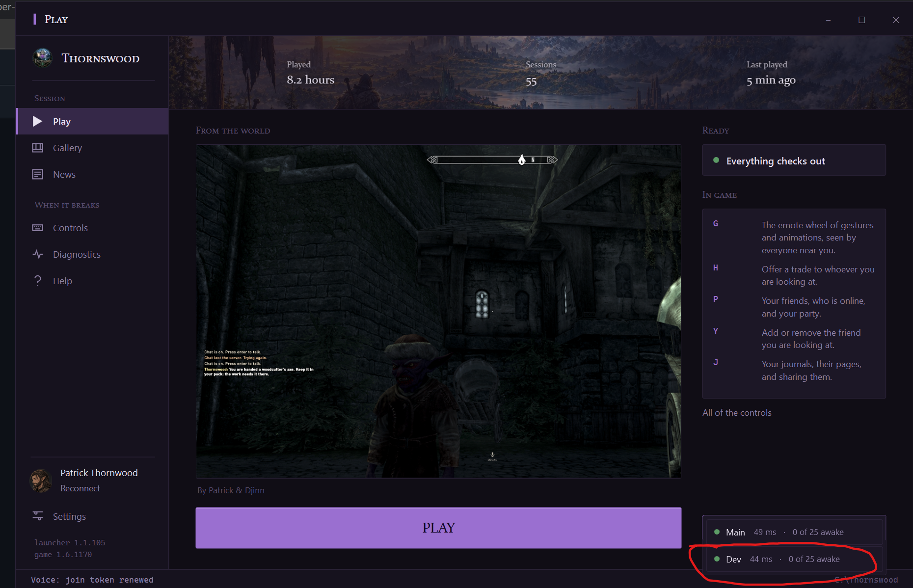

# Developer Guide

This is the one guide for working on Thornswood. A first day starts at section 1 and follows the numbers. A later day uses the table of contents, the glossary, or the outline in Visual Studio Code to open the heading you need. `CLAUDE.md` adds only what applies to a Claude.

The outline nests, and the table of contents follows it. A part is a numbered section. A group inside it is a subsection. A step inside that is a sub-subsection.

- Repository: https://github.com/EvilPatrick06/Thornswood
- Board: https://github.com/users/EvilPatrick06/projects/1
- Site: https://thornswood.net
- Staff pages: https://thornswood.net/hub
- Long glossary: [docs/GLOSSARY.md](docs/GLOSSARY.md)

## Table of Contents

- [Glossary](#glossary)
- [1. First Time Setup](#1-first-time-setup)
  - [On every PC](#on-every-pc)
    - [Install the tools](#install-the-tools)
      - [What each install is](#what-each-install-is)
    - [Check that the tools open](#check-that-the-tools-open)
    - [Install the OpenSSH client](#install-the-openssh-client)
      - [When the class is not registered](#when-the-class-is-not-registered)
    - [Sign the GitHub CLI into your account](#sign-the-github-cli-into-your-account)
    - [Clone the repository](#clone-the-repository)
    - [Open the folder in Visual Studio Code](#open-the-folder-in-visual-studio-code)
    - [Reach the VPS](#reach-the-vps)
  - [Setting up a machine](#setting-up-a-machine)
  - [Shipping from another machine](#shipping-from-another-machine)
    - [Your own signing sign in](#your-own-signing-sign-in)
      - [Patrick, once for each person](#patrick-once-for-each-person)
      - [The person, on their own machine](#the-person-on-their-own-machine)
      - [Never a device code](#never-a-device-code)
      - [When somebody stops shipping](#when-somebody-stops-shipping)
    - [Check the machine and Ship](#check-the-machine-and-ship)
- [2. How to make changes](#2-how-to-make-changes)
  - [On your branch](#on-your-branch)
    - [Start from a current main](#start-from-a-current-main)
    - [Save the work in a commit](#save-the-work-in-a-commit)
    - [Switch between branches](#switch-between-branches)
      - [Commit, then switch](#commit-then-switch)
      - [Set the edits aside](#set-the-edits-aside)
    - [Open the pull request](#open-the-pull-request)
      - [A one-line body](#a-one-line-body)
      - [A body of several lines](#a-body-of-several-lines)
      - [When the pull request will not open](#when-the-pull-request-will-not-open)
    - [Merge your own pull request](#merge-your-own-pull-request)
  - [The rules](#the-rules)
    - [What this is](#what-this-is)
    - [Words](#words)
    - [Fix the cause, no band-aids](#fix-the-cause-no-band-aids)
    - [Buttons, not chat commands](#buttons-not-chat-commands)
    - [Everything we need to do goes on the board](#everything-we-need-to-do-goes-on-the-board)
    - [What is not a reason to skip an issue](#what-is-not-a-reason-to-skip-an-issue)
    - [Settled design, not up for a quiet rewrite](#settled-design-not-up-for-a-quiet-rewrite)
    - [How work moves](#how-work-moves)
      - [Main, hotfixes, and merging](#main-hotfixes-and-merging)
      - [Branch names](#branch-names)
      - [Dev first, notes, and open branches](#dev-first-notes-and-open-branches)
      - [Signing, the build check, and the six shared files](#signing-the-build-check-and-the-six-shared-files)
    - [How work moves, the long form](#how-work-moves-the-long-form)
- [3. How to release to dev](#3-how-to-release-to-dev)
  - [The content plugin goes to the server first](#the-content-plugin-goes-to-the-server-first)
  - [Say so, then write the note](#say-so-then-write-the-note)
  - [Mark the dev notes again](#mark-the-dev-notes-again)
  - [Put the gamemode on the dev server](#put-the-gamemode-on-the-dev-server)
  - [Look before you post the news again](#look-before-you-post-the-news-again)
  - [What any developer may do](#what-any-developer-may-do)
- [4. How to release to main](#4-how-to-release-to-main)
  - [Move the version first](#move-the-version-first)
  - [The content plugin goes to the live server first](#the-content-plugin-goes-to-the-live-server-first)
  - [Ship main](#ship-main)
  - [Deploy the live pieces the pull request touched](#deploy-the-live-pieces-the-pull-request-touched)
  - [A hotfix](#a-hotfix)
  - [How a release goes out](#how-a-release-goes-out)
  - [After a pull request is merged](#after-a-pull-request-is-merged)
- [5. The system](#5-the-system)
  - [What Thornswood is](#what-thornswood-is)
  - [The pieces](#the-pieces)
  - [One Skyrim of its own](#one-skyrim-of-its-own)
  - [Where things are written down](#where-things-are-written-down)
- [6. FAQ](#6-faq)
  - [A. GitHub](#a-github)
    - [Sign in and look](#sign-in-and-look)
    - [Where your commits are](#where-your-commits-are)
    - [Learn more about GitHub](#learn-more-about-github)
  - [B. Git](#b-git)
    - [See the branch and the edits](#see-the-branch-and-the-edits)
    - [The commands the rest of the guide uses](#the-commands-the-rest-of-the-guide-uses)
    - [Learn more about Git](#learn-more-about-git)
  - [C. PowerShell](#c-powershell)
    - [Where you are](#where-you-are)
    - [Run a script from the repository folder](#run-a-script-from-the-repository-folder)
    - [Learn more about PowerShell](#learn-more-about-powershell)
  - [D. Visual Studio Code](#d-visual-studio-code)
    - [Open this repository](#open-this-repository)
    - [The parts of the window](#the-parts-of-the-window)
    - [Where to click](#where-to-click)
    - [Learn more about Visual Studio Code](#learn-more-about-visual-studio-code)
  - [E. VPS](#e-vps)
    - [Make a key and test it](#make-a-key-and-test-it)
    - [Two reads](#two-reads)
    - [Learn more about VPS](#learn-more-about-vps)
  - [F. Website](#f-website)
    - [Deploy](#deploy)
    - [Learn more about Website](#learn-more-about-website)
  - [G. Main Build](#g-main-build)
    - [Learn more about Main Build](#learn-more-about-main-build)
  - [H. Dev Build](#h-dev-build)
    - [Install it from the main launcher](#install-it-from-the-main-launcher)
    - [The Play page](#the-play-page)
    - [Learn more about Dev Build](#learn-more-about-dev-build)
  - [I. Bot](#i-bot)
    - [Deploy the code](#deploy-the-code)
    - [Learn more about Bot](#learn-more-about-bot)
  - [J. Node](#j-node)
    - [See the version and run a test](#see-the-version-and-run-a-test)
    - [Learn more about Node](#learn-more-about-node)
  - [K. Vortex](#k-vortex)
    - [Install the collection](#install-the-collection)
    - [Learn more about Vortex](#learn-more-about-vortex)
  - [L. Pandora](#l-pandora)
    - [Learn more about Pandora](#learn-more-about-pandora)
  - [M. Creation Kit](#m-creation-kit)
    - [Change a record](#change-a-record)
    - [Learn more about Creation Kit](#learn-more-about-creation-kit)
  - [N. The repository map](#n-the-repository-map)
    - [Why it is split this way](#why-it-is-split-this-way)
    - [How to move around](#how-to-move-around)
    - [What each folder is](#what-each-folder-is)
    - [Files you will open often](#files-you-will-open-often)
    - [Learn more about the repository](#learn-more-about-the-repository)
  - [O. Others](#o-others)
    - [Python](#python)
    - [The .NET Framework](#the-net-framework)
    - [SkyMP](#skymp)
    - [HTML](#html)
    - [CSS](#css)
    - [JavaScript](#javascript)
    - [Learn more about the other tools](#learn-more-about-the-other-tools)
  - [P. Secrets, by name and place, never by value](#p-secrets-by-name-and-place-never-by-value)
  - [Q. Staff commands](#q-staff-commands)
    - [Who may run them](#who-may-run-them)
    - [For yourself](#for-yourself)
    - [At somebody else](#at-somebody-else)
    - [Keeping order](#keeping-order)
    - [Bans, PKs and notes](#bans-pks-and-notes)
    - [Wounds for a scene](#wounds-for-a-scene)
    - [The embassy and remnant rolls](#the-embassy-and-remnant-rolls)
    - [Restarts](#restarts)
    - [In Discord](#in-discord)

## Glossary

The words this guide uses. The long alphabetical list, with file names, is [docs/GLOSSARY.md](docs/GLOSSARY.md).

| Term | Meaning |
| --- | --- |
| Repository | This project folder plus the history Git keeps for it |
| Clone | The copy of the repository on your PC |
| Commit | One saved step, with a message, on the branch you are on |
| Branch | A named line of commits. The folder shows one branch at a time |
| `main` | The shared branch. A live release is built from it |
| Pull request | The GitHub page that puts a branch's commits onto `main` when it is merged |
| Push | Upload the branch you are on to GitHub |
| Pull | Download new commits from GitHub onto the branch you are on |
| Ship | The command that builds a release and publishes one channel |
| Channel | `dev` or main. Each channel has its own feed, server, and news |
| Dev build | The second launcher, `Thornswood-DevBuild`, used to try a release |
| Main build | The live launcher install |
| Feed | `version.json` for one channel. The launcher reads it from the site |
| Baseline | The record of the files the last release on that channel shipped |
| Note | The release post: a title, then one line starting with `- ` for each thing a person will notice |
| VPS | The remote machine that runs the site, the bot, voice, and both game servers |
| Gamemode | `game\gamemode.js`, the rules the game server runs |
| Hotfix | A live release of one fix, built from the commit that is already live |
| Vortex | The mod manager. The Thornswood profile deploys the collection |
| Pandora | Pandora Behaviour Engine+. It builds the behavior files before a Ship |
| Creation Kit | Bethesda's tool for plugin records. A release does not ship the kit itself |
| Node | The program that runs the website, the voice service, and `node tests\...` |
| Bot | The Discord bot in the `bot` folder |
| Launcher builds | The check on a pull request. Merge when it says pass |
| Worktree | A second folder on this PC, checked out on its own branch |

## 1. First Time Setup

Do this once on a new Windows PC. Stay in order. On every PC is the steps. Setting up a machine and Shipping from another machine are for a PC that will publish a release. You can read those two after the clone works.

Use your own GitHub account. Patrick adds that account as a collaborator on the private repository before a clone will work. Say so in Discord and wait for that. Before your first change, read `LICENSE` at the root of the repository and say in #staff-general that you agree to its contributor terms. You agree once, and it covers anything you contributed before. Use your own clone. The shared folder `C:\Users\evilp\Downloads\Thornswood-Repo` on the shipping machine is for the lanes that build from it. Your clone can live at `C:\Dev\Thornswood`, or any empty folder you own.

### On every PC

#### Install the tools

Open PowerShell. Paste this and let each install finish. If Windows asks for an administrator, allow it.

```powershell
winget install --id Git.Git -e --accept-package-agreements --accept-source-agreements
winget install --id GitHub.cli -e --accept-package-agreements --accept-source-agreements
winget install --id OpenJS.NodeJS.LTS -e --accept-package-agreements --accept-source-agreements
winget install --id Microsoft.PowerShell -e --accept-package-agreements --accept-source-agreements
winget install --id Microsoft.VisualStudioCode -e --accept-package-agreements --accept-source-agreements
```

##### What each install is

| Program | What you use it for |
| --- | --- |
| Git | History of the folder on this PC. [B. Git](#b-git) |
| GitHub CLI (`gh`) | Pull requests from the terminal. [A. GitHub](#a-github) |
| Node | The website, voice, and the test command. [J. Node](#j-node) |
| PowerShell 7 | The terminal the scripts run in. [C. PowerShell](#c-powershell) |
| Visual Studio Code | The window you edit in. [D. Visual Studio Code](#d-visual-studio-code) |

#### Check that the tools open

Close that window and open **PowerShell 7** from the Start menu. A new window is required because Windows only sees newly installed programs in a window opened afterwards.

```powershell
git --version
gh --version
node --version
ssh -V
code --version
```

Each line should print a version. `code --version` prints a few lines, and the first is the version. If one says the program is not recognized, you are still in the old window.

```powershell
$PSVersionTable.PSVersion
```

The major number is 7 or higher when you are in PowerShell 7. If it prints 5, type `pwsh` and press Enter.

#### Install the OpenSSH client

The VPS scripts need `ssh`. If `ssh -V` already printed a version, this step is done.

```powershell
Add-WindowsCapability -Online -Name OpenSSH.Client~~~~0.0.1.0
```

##### When the class is not registered

Run the same install through DISM from an elevated PowerShell:

```powershell
dism /Online /Add-Capability /CapabilityName:OpenSSH.Client~~~~0.0.1.0
```

When DISM still fails, start Windows Update and run the DISM line again:

```powershell
Start-Service wuauserv
dism /Online /Add-Capability /CapabilityName:OpenSSH.Client~~~~0.0.1.0
```

`The operation completed successfully` means the client is installed. Check it:

```powershell
ssh -V
```

#### Sign the GitHub CLI into your account

```powershell
gh auth login
gh auth status
```

Choose GitHub.com, then HTTPS, then login with a browser, as the GitHub user that has access to the repository. `gh auth status` should name your account and say the token can see private repositories. More on the website is in [A. GitHub](#a-github).

#### Clone the repository

```powershell
New-Item -ItemType Directory -Force -Path C:\Dev | Out-Null
cd C:\Dev
git clone https://github.com/EvilPatrick06/Thornswood.git
cd C:\Dev\Thornswood
git status
```

`git status` should say you are on `main` and the working tree is clean. If the clone asks for a login and then fails, you are not a collaborator yet. Stop and say so in Discord.

From here on, the commands assume PowerShell is inside your clone. If you used another folder, `cd` there first.

#### Open the folder in Visual Studio Code

```powershell
cd C:\Dev\Thornswood
code .
```

`code .` opens the folder you are in. The window title shows Thornswood. If `code` is not recognized, close PowerShell, open PowerShell 7 again, `cd C:\Dev\Thornswood`, and run `code .` again.

The branch name is in the status bar at the bottom left. Open the terminal from the View menu, Terminal. It starts in the clone. The parts of the window are in [D. Visual Studio Code](#d-visual-studio-code). The folders, and the files a first change usually touches, are in [N. The repository map](#n-the-repository-map).

#### Reach the VPS

You do not get the server password. Your PC creates a key. You send the public line. Somebody who already has a key on the server adds yours.

```powershell
.\scripts\vps\Setup-SshKey.ps1 -KeyOnly
```

The script prints one line that starts with `ssh-ed25519`. Copy that whole line into Discord. Leave the private key file where the script put it. The reads, the test, and what the VPS is are in [E. VPS](#e-vps).

### Setting up a machine

Needs: Windows 10 or 11, Skyrim Special Edition on Steam (any Steam library,
any drive; the scripts find it through Steam) with the Thornswood collection
deployed through Vortex, the Thornswood launcher installed on any drive and
signed in, git, the GitHub CLI (`gh`) signed in to an account that is a
collaborator on the source repo, PowerShell 7, node, Python 3 with `discord.py`
and `Pillow` for the bot scripts, and an SSH key the VPS knows. There is no
releases clone any more: the feed and its baseline are on the VPS (#907).

```
cd C:\Users\<you>\Downloads
git clone https://github.com/EvilPatrick06/Thornswood.git Thornswood-Repo
gh auth login
gh auth status
```

The bot's libraries go into the Python that `py` starts by default, because
that is the one the bot harnesses run on: `bot\test-*.py`, and
`tests\test-staff-commands.js`, which imports bot.py. On the shipping machine
the default was 3.12 with no discord.py, so every bot harness stopped on its
first import with nothing to do with the change being tested (#1008). From
`Thornswood-Repo`:

```
py -m pip install -r bot\requirements.txt
py -c "import discord, PIL; print('discord.py ' + discord.__version__)"
```

The second line prints the discord.py version `bot\requirements.txt` pins when
the first worked. The nightly does the same into a venv of its own on the VPS,
because the live bot runs on that box's Python.

Every change goes to the dev channel first, and the dev channel needs the dev
build on this machine too: in the main launcher, on the Play page, the Server
dropdown, Dev. It checks your Discord roles first, then puts it
at `<drive>:\Thornswood-DevBuild`, beside the main install. Then open it once and let it make its own game folder,
`<Root>-DevBuild\Game`: it offers at startup, and its own Settings, Maintenance
has "Make it". Ship refuses `-Channel dev` without the dev build, and with the
dev build but without that folder it builds the dev release out of the Steam
copy instead. `.\scripts\release\Check-ShipReady.ps1 -Channel dev` says whether both are
in place, without shipping anything.

Then in `Thornswood-Repo`:

```
.\scripts\vps\Setup-SshKey.ps1 -KeyOnly
```

which makes a key for the VPS, points ssh at it, and prints the public line.
Send that line to Patrick; he runs `.\scripts\vps\Add-VpsKey.ps1 -PublicKey '<the line>'`
from his machine and the VPS knows you. `.\scripts\vps\Setup-SshKey.ps1 -Test`
proves it. Until then the scripts that talk to the VPS (`Ship`, `Deploy-*`,
`Request-Restart`, `Install-Bot`, `Publish-Installer`, `Publish-News`) cannot
reach it, and Ship stops before it builds anything: the feed and its baseline
are received from the VPS (#907).

Every Ship, dev included, checks the SkyMP client against the record, so
this machine builds the engine once (Visual Studio 2022 Build Tools with
"Desktop development with C++", node and yarn; the script says what is
missing):

```
.\scripts\release\Build-Engine.ps1
```

`engine\README.md` has the rest. A machine that only Ships does not need
to build it: `.\scripts\release\Setup-ShipMachine.ps1` fetches the recorded
client from the site instead (Shipping from another machine, below). The
release webhooks are on the VPS (`scripts\ops\Discord-Hook.ps1`) and every
Ship reads them from there, so there is nothing to hand over.

The launcher builds with MSBuild (#498, decided by Patrick on 11 Oct,
switched 15 Oct). A dev Ship builds the launcher on the machine that runs
it, so every machine that Ships needs Visual Studio 2022 Build Tools with
the MSBuild component and the .NET Framework 4.8.1 targeting pack. The VPS
build runners get the same two parts from `Bootstrap-VPS.ps1
-IncludeBuildTools`. Nothing else is downloaded at build time: no .NET SDK,
no NuGet. A
machine with no Build Tools yet, in PowerShell 7 (Windows asks for an
administrator):

```
winget install --id Microsoft.VisualStudio.2022.BuildTools -e --accept-package-agreements --accept-source-agreements --override "--quiet --wait --norestart --add Microsoft.VisualStudio.Workload.MSBuildTools --add Microsoft.Net.Component.4.8.1.TargetingPack"
```

A machine that already has Build Tools, for the engine above, adds the one
component to the install it has:

```
& "${env:ProgramFiles(x86)}\Microsoft Visual Studio\Installer\setup.exe" modify --installPath "${env:ProgramFiles(x86)}\Microsoft Visual Studio\2022\BuildTools" --add Microsoft.Net.Component.4.8.1.TargetingPack --quiet --norestart
```

Visual Studio 2022 or newer itself, any edition, with the ".NET desktop
development" workload, is just as good (GitHub's runner builds it with Visual
Studio 18). Then, from `Thornswood-Repo`:

```
.\scripts\release\Find-MSBuild.ps1 -Report
.\scripts\release\Build-Launcher.ps1 -Root $env:TEMP\msbuild-try -NoPause
```

The first names MSBuild.exe and the 4.8.1 reference assemblies, or says
which is missing. The second builds both exes into a scratch folder and
ends with Done. Since the switch (#498, 15 Oct) this is the only way the
launcher builds, so `Setup-ShipMachine.ps1 -Check` and `Check-ShipReady.ps1`
count a machine without it as a gap.

The pack baseline lives on the VPS beside the feed, and every Ship receives it
first, so there is nothing to pull. If the VPS has none for a channel, Ship
stops with "No baseline yet". To rebuild a baseline by hand:

```
.\scripts\release\Publish-Update.ps1 -Baseline
```

which records what the game folder holds right now without shipping anything. Do it
straight after the launcher has brought the game up to date, so the baseline is the
current release and the first real Ship carries only what you changed.

`Publish-Discord.ps1` reads the #news webhook and the dev updates one from
the VPS through `Discord-Hook.ps1`, and a copy in `bot\news-webhook.txt` or
`bot\dev-webhook.txt` only when the VPS cannot be asked; without either, Ship
says so and carries on.

### Shipping from another machine

Issue #458: if One (Patrick's machine) dies, the release process has to
survive it. Measured on One on 29 September, this is everything a dev Ship
reads that is not in a fresh clone, where it is on One, and where a second
machine gets it or how it is rebuilt. Nothing in this list is copied from One
by hand, and no secret is written into the repository.

| What a Ship needs | On One | A second machine |
| --- | --- | --- |
| The source | the shared clone | `git clone https://github.com/EvilPatrick06/Thornswood.git` and `gh auth login` as a collaborator |
| The feed, its baseline, the launcher list and history | the VPS store, with a working copy in `%LOCALAPPDATA%\Thornswood\feed\<channel>` | Nothing to copy: every Ship receives them from the VPS first (`scripts\release\Feed-Store.ps1`, #907). The working copy is made on the first Ship |
| The release webhooks, dev and #news | the VPS, `C:\Thornswood-Bot\webhooks`; One has no local copy | Nothing to copy: Ship reads them over ssh (`scripts\ops\Discord-Hook.ps1`) |
| VPS access | One's own key, `.ssh\thornswood_ed25519` | Its own key: `.\scripts\vps\Setup-SshKey.ps1 -KeyOnly`, and somebody the VPS already knows runs `.\scripts\vps\Add-VpsKey.ps1 -PublicKey '<the line>'`. With no such machine left, the BisectHosting panel is the way in (`docs\IT-IS-DOWN.md`) |
| Signing: `records\signing\signing.json` | written from the template like any other machine's since 5 Oct, when `C:\tools` (an older copy of `metadata.json`) was removed. Never copy one machine's to another | `.\scripts\release\Setup-ShipMachine.ps1` writes one from `records\signing\signing.template.json` (paths and "enabled": true, no key or password) |
| Signing: Microsoft's signing client | `records\signing\client`, ignored by git | The same script fetches `Microsoft.ArtifactSigning.Client` 1.0.128 from nuget.org and refuses it unless its sha256 is the pinned one, which is the package One has |
| Signing: the Azure sign in | `az login` on One, as Patrick | `az login` on the new machine, as the person who ships from it, with an account of their own in the signing tenant that holds the Certificate Profile Signer role on the ThornswoodSigning account's profile ThornswoodRelease (Patrick, 4 Oct; #1740). Patrick makes the account and gives the role once: [Your own signing sign in](#your-own-signing-sign-in). The script asks the signing service with that sign in and checks the profile answers with the identity the launcher pins |
| The client runtime `records\client-build.json` names | only in the dev game folder, `C:\Thornswood-DevBuild\Game`. The build copies in `Downloads\Thornswood-ClientBuild-<commit>` are older builds, and the shared clone's `engine\skymp\build` does not match the record | The script fetches the zip of the recorded commit from the site's feed (`clientRuntime` in `/feed-dev/version.json` or `/feed/version.json`), checks it against the feed's sha256 and every file against the record, and puts the six files in the build folder. A commit on neither feed is built: `.\scripts\release\Setup-ShipMachine.ps1 -Rebuild`, or `.\scripts\release\Build-Engine.ps1` |
| The game folder the Ship packs, `<root>-DevBuild\Game` | built by the dev launcher from what Vortex deployed | Skyrim Special Edition on Steam, Vortex with a profile named Thornswood and the Thornswood collection installed and deployed, the launcher from thornswood.net, then the dev build and its own game folder (Setting up a machine, above). A person does this; it needs a Nexus account, not Patrick's |
| The collection itself | Nexus collection `7essxf`, curated from Patrick's Nexus account in his Vortex | Any machine installs it. Only publishing a new revision needs his account (`docs\OWNERSHIP.md`) |
| Backups | the originals on the VPS, `C:\Thornswood-Backup`, and copies fetched to `local\backups` in One's repository folder (`.\scripts\release\Where.ps1 Backups`); the passphrase on the VPS and in One's Documents | Not needed to Ship. `.\scripts\vps\Fetch-Backups.ps1` brings them down to any machine the VPS knows |

#### Your own signing sign in

Until 4 Oct only Patrick's Azure account could sign (29 Sep, #1121), so a
second machine signed only while he sat at it and signed in. Since 4 Oct each
person who ships signs in as themselves, with an account of their own in the
signing tenant, Default Directory (`5a096034-ce55-40d2-b313-10ee86efe26a`, domain
`evilpatrick06outlook.onmicrosoft.com`), that holds the Artifact Signing Certificate
Profile Signer role on the ThornswoodRelease profile (Patrick, 4 Oct; #1740).
The role is on that profile only, so the account can sign and can do nothing
else in the subscription. What it signs carries the same publisher name as
what Patrick signs, because the certificate comes from his identity
validation. Accounts that can sign, 4 Oct: Patrick's own, and
`djinn@evilpatrick06outlook.onmicrosoft.com`.

##### Patrick, once for each person

On a machine where `az` is signed in as Patrick, in PowerShell 7:

```powershell
az account show --query "{user:user.name, tenant:tenantId}" -o table
```

It names evilpatrick06@outlook.com and the tenant above. Then:

```powershell
$scope = (az resource list --name ThornswoodSigning --resource-type Microsoft.CodeSigning/codeSigningAccounts --query "[0].id" -o tsv) + "/certificateProfiles/ThornswoodRelease"; $scope
$domain = (az ad signed-in-user show --query userPrincipalName -o tsv).Split('@')[1]; $domain
$who = Read-Host 'Their name, one lower case word'
$pw = 'Tw7' + (-join ((48..57) + (65..90) + (97..122) | Get-Random -Count 17 | ForEach-Object { [char]$_ })); $id = az ad user create --display-name $who --user-principal-name "$who@$domain" --password $pw --force-change-password-next-sign-in true --query id -o tsv; $id
$role = az role definition list --query "[?ends_with(roleName, 'Certificate Profile Signer')].roleName" -o tsv | Select-Object -First 1; $role
az role assignment create --assignee-object-id $id --assignee-principal-type User --role $role --scope $scope
"$who@$domain   $pw"
```

The first line prints a path that starts with `/subscriptions/` and ends with
`/certificateProfiles/ThornswoodRelease`. The second prints the domain above.
The account line prints the new account's id, the role line prints Artifact
Signing Certificate Profile Signer, and the assignment prints the role and
that path. The last line is the account and a first password: send both to
the person in a direct message, never a channel. They have to change it the
first time they sign in, so it stops working after that.

##### The person, on their own machine

In PowerShell 7, in the repository folder:

```powershell
az config set core.enable_broker_on_windows=false
az login --tenant 5a096034-ce55-40d2-b313-10ee86efe26a --allow-no-subscriptions
.\scripts\release\Setup-ShipMachine.ps1 -Check
```

The first line makes `az` sign in through your web browser. On Windows it
opens a sign in window of its own by default, and on 4 Oct that window sent
a work account to the page for personal Microsoft accounts, which answered
"That Microsoft account doesn't exist". The second opens the tenant's own
sign in page: sign in with the account Patrick sent, set a new password, and
set up Microsoft Authenticator when it asks. It ends by printing the tenant
above and your account. The account has no subscription of its own to list,
which is what `--allow-no-subscriptions` is for. `Setup-ShipMachine.ps1 -Check`
then says, under 4, that profile ThornswoodRelease answers this sign in with
the identity the launcher pins. A role given a few minutes ago can take a
little longer to reach the signing service.

##### Never a device code

`az login --use-device-code` does not work here, for anybody. The tenant has
Microsoft's security defaults on, and they refuse every device code sign in:
AADSTS530035, "Access has been blocked by security defaults", measured on
4 Oct when Patrick entered a code for Djinn's machine. Do not turn security
defaults off to get past it. They are what puts MFA on every account that
can sign.

##### When somebody stops shipping

Patrick, with `$scope` and `$domain` set as above:

```powershell
$who = Read-Host 'Their name, as it is before the @'
az role assignment delete --assignee "$who@$domain" --scope $scope
az ad user delete --id "$who@$domain"
```

The first takes the role away and the second removes the account. Neither
prints anything when it worked.

#### Check the machine and Ship

The whole of it, on the second machine, from the repository folder:

```
.\scripts\release\Setup-ShipMachine.ps1 -Check
```

says what the machine has and what it would fetch or write, and changes
nothing.

```
.\scripts\release\Setup-ShipMachine.ps1
```

checks the tools a Ship calls (git, gh, PowerShell 7, node, ssh, the .NET
Framework compiler, signtool, az, the .NET 8 runtime), fetches the signing
client, writes `records\signing\signing.json`, checks the Azure sign in, fetches the
recorded client, and then runs `.\scripts\release\Check-ShipReady.ps1 -Channel dev`
for everything else Ship asks: the dev build, its game folder, the Vortex
profile, the VPS and the feed store. Each gap prints the command that closes
it and says when it is Patrick's. It never turns signing off, never edits a
`records\signing\signing.json` that is there, and never ships. The sign in is
the one step that needs Patrick, once for each person (Your own signing sign
in, above). When both say READY:

```
.\scripts\release\Ship.ps1 -Channel dev "what changed, in plain words
- one line for each thing a person will notice"
```

Any developer may run a main Ship from a machine that can sign (How work moves). The same script with
`-Channel main` checks a machine for it.

Ship builds a channel's release from one folder on each machine: the main
install for main and `<Root>-DevBuild` for dev, unless the machine has
recorded another (issue #1692). On a machine whose Vortex deploys into the
dev build's game folder (docs/COLLECTION-REVISION-2.md step 8), record the
release folder once. On One it is `local\release-devbuild` in the
repository folder since 5 Oct, because Thornswood work on One lives only in
the repository, the vault and `C:\ThornswoodTemps&Worktrees` (Patrick); give
the whole path, since every clone and worktree reads what is recorded:

```
.\scripts\release\Setup-ShipMachine.ps1 -Channel dev -Root C:\Users\evilp\Downloads\Thornswood-Repo\local\release-devbuild
```

It writes the file `.\scripts\release\Where.ps1 ShipRoots` names, in this
machine's own data, so every clone and worktree reads it, and Ship,
Check-ShipReady and Build-Generated then take that folder without `-Root`.
Ship and Check-ShipReady refuse a folder Vortex deploys into, before
anything is built.

Moving a release folder means building its generated files once more
afterwards, `.\scripts\mods\Build-Generated.ps1 -Channel dev`, because
`generated.txt` records the game folder they were built for and Ship
refuses them for any other.

`tests\test-ship-machine.ps1` walks this section: every script it names is
in the repository with the parameters it is given, the template holds paths
only, and the fetch refuses a signing client or a client runtime that is not
the pinned or recorded bytes.

## 2. How to make changes

One issue, one branch, one pull request. Your commits sit on that branch. `main` on GitHub gains them when the pull request is merged. On your branch is the steps. The rules are the next group. A review and the build check hold you to them.

### On your branch

#### Start from a current main

```powershell
git switch main
git pull
git switch -c yourname/short-name
```

`yourname` is your name in lowercase. `short-name` is the job, with hyphens. Example: `alex/fix-door-list`. `git switch -c` creates the branch and puts the folder on it. `git checkout -b yourname/short-name` creates it the same way. Later sections use `git checkout` for that move.

#### Save the work in a commit

Save the file in the editor first (`Ctrl+S`). A save writes the file into whichever branch is current.

```powershell
git status
git diff
git add path\to\file
git commit -m "Fix the door list so a staff role still gets in."
```

`nothing to commit, working tree clean` means the folder matches this branch. A list of files means those edits become part of the branch when you commit them. That commit is on this PC until you push.

```powershell
git push -u origin HEAD
```

The first push sets the upstream. It puts this branch on GitHub under the same name. `main` on GitHub stays as it is.

#### Switch between branches

The folder shows one branch at a time. The files in Visual Studio Code are the branch named in the status bar. Every other local branch stays on this PC with its own commits.

```powershell
git branch
git status
```

A star marks the branch in the folder. `git branch -vv` also shows the GitHub branch each one tracks.

##### Commit, then switch

```powershell
git add path\to\file
git commit -m "Save the door list work on this branch."
git switch yourname/other-job
```

The door-list commit stays on the branch you left. Come back with `git switch yourname/short-name`. `git switch -` returns to the branch you were on before this one.

Start a second job from a current `main`. The first branch keeps the commits you already made:

```powershell
git switch main
git pull
git switch -c yourname/second-job
```

##### Set the edits aside

```powershell
git stash
git switch yourname/other-job
```

The folder is clean and shows the other branch. Return to the branch you stashed from and put the edits back:

```powershell
git switch yourname/short-name
git stash pop
```

`git stash list` shows what is still set aside. Pop on the branch you stashed from.

When the switch stops, those uncommitted edits touch a file that differs on the branch you asked for. You are still on the current branch, and the edits are still in the folder. Commit them, or stash them, then switch.

#### Open the pull request

`gh pr create` uses the branch you have checked out. A one-line body uses ordinary double quotes. PowerShell treats `@" ` as the start of a here-string, and a here-string needs a line break immediately after `@"`. Characters on that same line raise `No characters are allowed after a here-string header`.

##### A one-line body

```powershell
gh pr create --title "Tools to 50" --body "Reduced tools from 100 to 50 on uses"
```

##### A body of several lines

```powershell
$body = @"
What changed.

How you tested it.

Closes #123
"@
gh pr create --title "Short title" --body $body
```

The title says what changed. The body says how you tested it. If the work finishes an issue, put `Closes #123` in the body. A fix people would notice says `Refs #123` instead, because its issue is closed with a `Test task:` comment when the fix reaches main ([Everything we need to do goes on the board](#everything-we-need-to-do-goes-on-the-board)). The pull request targets `main`.

Run the test that covers your change before you open the pull request.

```powershell
node tests\test-site-local.js
.\scripts\dev\Check-Words.ps1
```

Use the file in `tests\` whose name matches the area you touched. Pages, docs, and launcher help that a person will read go through `Check-Words.ps1`.

##### When the pull request will not open

**The push is not a fast-forward.** Your local branch is behind the same branch on GitHub. Bring the remote commits in, then create the pull request:

```powershell
git pull
gh pr create --title "Tools to 50" --body "Reduced tools from 100 to 50 on uses"
```

If `git pull` says there is no tracking information, name the remote and the branch. Use the name `git status` prints for yours.

```powershell
git pull origin yourname/short-name
git branch --set-upstream-to=origin/yourname/short-name
git pull
```

**You rewrote the branch on purpose** (`git commit --amend` or `git rebase`) and you mean to replace the remote copy of that same branch:

```powershell
git push --force
```

Force push replaces the remote branch. Use it on your own branch after you rewrote that branch. Main refuses a force push. If `main` moved while you were working:

```powershell
git fetch origin
git rebase origin/main
git push
```

**The pull stopped on a conflict.** Git will not commit while a file is unmerged. Open the file it names, often `game\gamemode.js`. Find the markers `<<<<<<<`, `=======`, and `>>>>>>>`. Keep the code you want and delete the marker lines. Save the file.

```powershell
git add game\gamemode.js
git commit -m "Resolve merge conflict in gamemode.js"
```

If the stop was a rebase rather than a merge, the last step is `git rebase --continue` after the `git add`.

#### Merge your own pull request

Wait until the check named `Launcher builds` is green on the commit you are merging. Pending means it is still running. A red check means the branch is not ready. Fix it on the same branch and push again.

```powershell
gh pr checks
gh pr merge --squash
git switch main
git pull
```

When `Launcher builds` says pass, and you are confident in the change, merge it yourself. Say what you merged in #staff-general. On the website the button is **Squash and merge**. GitHub deletes the branch after a squash merge. A green check is required. Merge a pull request you understand. Leave one you do not.

What you run after the merge depends on what the pull request touched. A dev release is [section 3](#3-how-to-release-to-dev). A main release is [section 4](#4-how-to-release-to-main).

### The rules

#### What this is

Thornswood: a modded co-op Skyrim roleplay server on SkyMP, in alpha and
open by application. This repo is the launcher (launcher\app, C# 13 and WPF on
the .NET Framework 4.8.1, built with MSBuild from launcher\app\Thornswood.csproj,
#498), the game plugins (game\plugins, Skyrim Platform
JavaScript), the site (site, node), the Discord bot (bot,
Python) and every script that ships or runs it. Owner: Patrick (EvilPatrick06).

Nothing here assumes you use Claude: this file is the rules for everybody, and a Claude
reads the same file. CLAUDE.md only adds what is about a Claude. A new developer
is added as a collaborator on the repository, and on CODEOWNERS beside the
shared files, and agrees once to the contributor terms in `LICENSE`.
Thornswood's own work is all rights reserved (Patrick, 12 Oct, #1331).

Patrick's Grok Bot lanes (Smeagle, Launcher, Installer, Website, GitHub,
Vortex) also work here, on the shipping machine, under his GitHub account.
Every rule in this file binds them the same as a person. They share notes
through an Obsidian vault at `C:\Thornswood Vault\Thornswood` on that machine
(`wiki/status.md` is what is true now); the vault is for coordinating, and
the board is still the one record of work. They mark what they are on with a
`claimed: <lane>` label and the board card moved to In Progress. When the
issue closes, `.github\workflows\drop-claims.yml` takes every `claimed:`
label off it (#1863), so a lane's finish step need not. Their
branches carry the lane's name (`launcher/`, `website/`, `github/` and so on).
On the shipping machine `C:\Users\evilp\Downloads\Thornswood-Repo` is shared
by all of them and sits detached at `origin/main`, because lanes build from
it: branch work goes in a worktree beside it, removed with its branch once
the pull request merges.

One rule binds the lanes and not a person (Patrick, 11 Oct): a lane only
commits, pushes and merges. It never runs a Ship, a Deploy-*, Publish-* or
Install-* script, a step on the live or dev server, or a Vortex step. For each
change that needs a run, the lane writes one note in the vault's
`wiki/claude-queue/` folder with the exact command, its risks, draft release
notes, and a news post when people would notice; the README in that folder
has the template. A Claude on the shipping machine runs those notes. A lane
does not ask anybody to approve a deploy; the note is the hand-off.

#### Words

The people in the world are customers, clients, people, testers, partners.
Never "player". No em dashes anywhere written for people. Plain, direct
sentences, no filler, no placeholders. Secrets (server passwords, site keys,
Discord tokens, the news webhook, anything out of a config.json or .env on the
VPS) are named by location only; never printed, pasted, committed or logged.

What checks these, since 29 Sep (issue #460). Every pull request's build
(`Launcher builds`, step "Check the writing rules") runs
`scripts\dev\Check-Words.ps1` over every Markdown file outside `lore\` and
`docs\archive\`, the launcher's help and window, the bot's channel posts,
the public pages of the site, and the installer's read
me. Each hit names the file, the line and the rule, and turns the build red:

| Rule | What it refuses |
| --- | --- |
| `em-dash` | an em dash, typed or as an HTML entity |
| `banned-word` | the word this section bans, any case; multiplayer and playtest pass |
| `old-owner` | the old owner name |
| `open-alpha` | calling the alpha a playtest that is closed; it is open by application |
| `placeholder` | a marker left for later, in capitals (to do, to be decided, fix me), or filler Latin |
| `names-person` | a person's name in README.md or the six component READMEs (launcher, site, voice, game\plugins, game\ui, installer\setup) |

A line that has to say it anyway (this section naming the word it bans, a
document quoting a note as it went out) goes in
`scripts\dev\Check-Words.allow.txt` with its reason; an allowance that no
longer matches anything is itself a hit. Release notes are not files, so
`scripts\release\Note-Rules.ps1` checks them when Ship or Rollback-Feed runs,
before anything is built. The same build step runs `tests\test-check-words.ps1`
and `tests\test-note-rules.ps1`, which plant a break of every rule and fail
if either check lets one through. Secrets are checked by
`scripts\dev\Check-Secrets.ps1` in the same build. It reads the files of
`engine\skymp` too whenever the fork is checked out, and says so when it is
not (#1326); the build leaves it out, and the nightly fetches it at its pin
and reads it every night (`tests\test-1326-engine-secrets.ps1`).

Two names are in no tracked file at all, code, tests, records, data,
`docs\archive` and binary files included, and the build turns red when one
comes back: the multiplayer mod this build replaced (#497,
`tests\test-old-name-gone.js`), and the SkyMP server `Thornswood-Content.esp`
was salvaged from (#400, Patrick, 12 Oct: "no records may keep it";
`tests\test-other-server-name-gone.js`), along with that server's two short
forms, the prefix its editor ids, scripts and folders carried (Patrick,
15 Oct, decision C). Say "the other server" in prose and OtherServer in a
file, folder or code name. A check that has to find that server's leftovers
on a machine matches them by their shape, never by its name: its parking
folder in Data is `_disabledBy` and a name, its backup and plugin list
beside the game are `<name>-backup-<version>` and `_<name>-plugins-off`
(`scripts\release\Ship-Rules.ps1`, Test-ShipOtherServer), and any other file
of its is simply not on the list of ours.

No machine checks these, so the person writing keeps them: plain, direct
sentences with no filler; the text inside code (the launcher's messages, the
game's chat lines, the bot's replies), because a word check there cannot
tell a message from a name in the code or one of Skyrim's own record names;
and names in the other documents, which record who decided something and
who holds what on purpose.

#### Fix the cause, no band-aids

Decided by Patrick on 4 Oct: "lets ban patching or bandaids for fixes and
actually fix things", and in the same conversation, no band-aids and no patch
work at all. What prompted it: a Riekling lost its clothes walking out of the
Bannered Mare to the remount added for #614, code that existed to cover a
neck fault nobody had found, and the first fix offered for that was a second
layer that made the remount retry (#1601, closed unmerged).

A fix finds why something goes wrong and changes that. None of these is a
fix, whoever writes it and however small:

- code that notices the damage and undoes it: re-equip loops, putting
  something back when it is found off, a watcher on a timer that repairs
  state, a second ask in case the first one was ignored;
- a retry, a wait or a delay that hopes a race comes out right, instead of
  putting the steps in order;
- taking something off and putting it back, or reloading it, so the engine
  draws it again;
- a layer over an earlier band-aid to cover what that one broke;
- catching an error and carrying on, hiding a message, or turning a check off
  so the symptom stops showing.

Before a fix is written, its issue says what causes the problem and how that
was measured: the log line and its time, the file, the record, the steps that
make it happen. While the cause is not known, finding it is the work: write
on the issue what was measured and what is still unknown, and ship nothing for
it in the meantime. A cause in the engine is fixed in the fork
(`engine\skymp`), not worked around in a plugin or the gamemode.

The band-aids already in the tree are defects, and each one goes on the
board. Taking one out means finding the cause it covered and fixing that in
the same pull request. The dress asks came out with their cause, an
equipment record the server could not write (#1560): in `game\gamemode.js`
the wear script's retries, the `wearWhatIsWorn` ask at login and the
`dressIfBare` watch (#1604), and in `game\plugins\thornswood-front.js` the
front putting the shift on by itself. The Riekling and Goblin clothes remount
(#614) came out on 4 Oct (#1681) before its cause was found, decided by
Patrick because it was taking clothes off at every door; the front plugin's
race read is measuring that cause, and #614 stays open until it is fixed.

A retry is allowed only where failing is outside our control and expected:
a request over the network, a file another program has open. The reason is
written beside it, and it stops and says so instead of looping.

Every pull request says, under What changed, what the cause was and how it
was found. One that cannot say it is not merged.

#### Buttons, not chat commands

Decided by Patrick on 4 Oct: "no more commands for things [people] do,
only for dev and staff commands; everything else takes buttons and GUI".
Anything a person does in the world is a key, a prompt, a panel or the
thing itself activated, never a line typed in the chat. Staff and dev
commands stay commands. So do `/stuck` and the lines that reach staff,
`/helpme` and `/report`, and help text names them (Patrick, later on
4 Oct: "change it to except the /stuck and the ones for getting help
from GMs"). So do the ways of saying a line, `/me`, `/do`, `/w`, `/s`,
`/y` and `/ooc`, and `/roll`, with no buttons for them (Patrick, 4 Oct:
"Allow those commands and don't do buttons"). So does `/needs`, the
needs bars as a line of text for somebody who hid them (Patrick,
11 Oct, #2267). Never add another chat command for people. A panel
may send the server a line, but no person is told to type it and help text never lists it. [docs/SYSTEMS.md](docs/SYSTEMS.md), "Buttons, not
commands", is the rule and what counts as a button;
[docs/systems/commands.md](docs/systems/commands.md) lists every command
there is today and the issue that converts each one that does not stay.

#### Everything we need to do goes on the board

The one record of outstanding work is the Thornswood To Do board:
https://github.com/users/EvilPatrick06/projects/1

Each piece of work is an issue on this repository, and every issue is on the
board. Decided by Patrick on 25 Sep and approved in #staff-general: the list moved there
from a claude.ai page that nobody without Claude could open. The 169 open
entries became issues #368 to #536, each keeping its old number as its Order.
`docs/archive/todo-list-2026-09-25.md` holds every entry as it stood that day,
the finished ones included, so a comment in the code that says "entry 243 on
the To Do List" means entry 243 in that file.

Decided by Patrick on 17 Sep. Anything a session turns up goes on the board
before the session ends. A defect, a decision, a correction to something
already on there, or work started and not finished. Saying it in a chat or a
reply is not recording it: that is gone when the window closes and the next
person has no way to know it was ever found. What prompted this was a Google
Ads tag added to the site whose only trace was a paragraph on a neighbouring
entry, with no step telling anybody to deploy it.

How to use it:

- Order is the do-order. A new issue gets the Order of where it belongs, not
  the end; a number between two others (52.5) is fine.
- Work that fits an existing issue is an edit or a comment on it, not a
  second issue. Write down what was measured and what is left.
- Uncommitted changes sitting in the repo are outstanding work and belong on
  the board too.
- Labels: `wave:` is the stage, `area:` the part of the project, `needs:` who
  or what it waits on, and `anyone can start` marks what needs nobody in
  particular. Assign yourself when you start one.
- A pull request that finishes an issue says `Closes #N`, so merging closes
  it and the board moves it to Done. Say in the pull request, or in #staff-general,
  which issues moved.
- A fix people would notice is the exception: its pull request says `Refs #N`,
  and the issue stays open until the fix reaches main (Patrick, 11 Oct: dev
  is where the team checks that nothing breaks the game, and main is where
  testers test, since we are in alpha). When it is on main, whoever fixed it
  writes a comment on the issue whose first line is `Test task: <a title of
  at most 45 characters>`, then numbered steps in plain English and what
  should happen, with no issue numbers, links or code, and closes the issue.
  The bot turns that comment into a post in the #test-tasks forum the moment
  the issue closes, tagged Main, so closing it when it merges or when it
  reaches dev sends testers to look for a fix that main does not have. Write
  `Server: Main` on the line under the title, or no `Server:` line at all.
- Most test tasks are Main, because testers play on main in the alpha and dev
  is where the team checks nothing is broken (Patrick, 12 Oct). When the code
  is done and someone on dev has to measure something first, write a
  `Test task:` comment with `Server: Dev` on the line under the title, and
  leave the issue open. That one is for developers, so write it in developer
  terms: the files, log lines and commands to run, and what each should
  print, with a `Build:` line naming the dev release or gamemode commit it
  needs. The bot posts it at once in #dev-test-tasks, a forum in the Staff
  category that only staff see, whole, with links to the issue, its pull
  requests and commits, and its labels. It takes the post down when the
  issue closes or a newer `Test task:` comment does not say `Server: Dev`.
  Put what was measured on the issue: the post is deleted when it goes. When
  the fix reaches main, write the Main test task in plain words and close
  the issue as above, and it moves to #test-tasks (`bot\README.md`, Testing).

#### What is not a reason to skip an issue

Decided by Patrick on 11 Oct, after a pick of ten issues to work left out the
ones that needed him, needed the VPS, or named a later date. Choosing work
from the board, none of these three puts an issue aside:

- **It needs Patrick's decision.** Write the decision out in full, on the
  issue and to him: what is wrong, what was measured, each option and what it
  would do, and which one you recommend. Then he answers and the work goes
  ahead. His words: "If it needs my decision just give me the decision in
  full with my different options so we can get them done".
- **It needs the VPS.** The key is on the shipping machine and the scripts in
  `scripts\vps` and `scripts\deploy` reach the box, so VPS work is done by
  whoever takes the issue, not handed to Patrick. When a tool or permission
  layer refuses a command, say which one and ask Patrick for the rule. His
  words: "You have VPS access so you can do those ones".
- **It waits on a date.** Many dates written in issues were made up by an
  agent that did not want to do the work then. Check whether something real
  waits on that date, a release that is not out yet or a booked event, and if
  nothing does, do the work now. His words: "A date that hasn't come yet
  those might just be made up dates because agents were too lazy do those
  issues now".

#### Settled design, not up for a quiet rewrite

- Decided by Patrick and Djinn on 17 Sep, after the three launchers kept
  getting into each other's files: Thornswood runs from its own game folder
  (`Thornswood\Game`), built by the launcher from what Vortex has deployed
  into the Steam copy, the big files as hard links so the collection is not
  stored twice, and copies of everything another launcher rewrites in place
  (settings, scripts, programs, the client folders, the master files and
  whatever else rewrites a copied file in place). Decided by Patrick on
  20 Sep: nothing here supports another server's install any more. The SkyMP
  client runtime is built from the fork and recorded in
  `records\client-build.json`; `Sync-Client.ps1` puts it in the game folder and
  Ship refuses a release whose client is not the recorded build. Nothing is
  taken from the Steam copy's `Data\Platform` or its SkyMP DLLs, because until
  that day another launcher's builds of all of them were what shipped.
  This is what ships now, corrected 18 Sep. The bullet used to say the Steam
  copy shipped until `djinn/own-game-folder` reached main. That branch is on
  main, `C:\Thornswood\Game` is built, and the launcher restarts into it:
  Profile\launcher.log records "runs from the new folder". A session reading
  the old wording would have believed the wrong layout was live, which is the
  one thing this section exists to prevent.
  Decided by Patrick on 24 Sep, for a tester whose Vortex deploys into
  another server's copy of Skyrim (its own folder under `steamapps\common`), in
  his words "detcts and fixes this but doesnt have the servers bleed": when
  Vortex deploys anywhere but the Steam copy, `Thornswood\Game` is the Steam
  copy's game plus exactly the files Vortex's record in that folder lists,
  taken from Vortex's own mods folder, and nothing else of that folder is
  read. Scan names the folder, Fix and Settings point the launcher at it,
  and with no Steam copy on the machine it refuses (OwnGame.DeploysInto,
  Gather, tests\test-vortex-folder.ps1). Djinn to agree it in #staff-general.
  Decided by Patrick on 29 Sep (#1218, #1226): the Steam copy is the
  person's, to play vanilla at any build with their own mods, and Thornswood
  runs entirely from its own folder. With the own folder chosen in the setup
  window, first setup never writes into the Steam copy: the installer's
  payload and everything the launcher writes before the folder exists go to
  `Profile\Payload` (Paths.OwnFirst), and Make takes them in. Not chosen, the
  install uses the Steam copy as it always did, and once the folder is turned
  on and made the next start takes Thornswood's files back out of the Steam
  copy, once (OwnGame.CleanSteamCopy); an existing own folder gets the same
  from its next update. Steam's "Wait until I launch the game" is set only
  until the folder exists (tests\test-own-folder-first.ps1).
  Decided by Patrick on 29 Sep (#1232): `Thornswood\Game` takes only
  Skyrim's own files (from the Steam copy when it is on the pinned build, or
  the Downgrade's download), Vortex's deployed files by Vortex's own record,
  and Thornswood's own files. Skyrim's own is the pinned build's file list,
  `records\skyrim-files.json`, read out of the depot manifests the Downgrade
  uses, never a guess by folder. A mod put into the Steam copy by hand stays
  there, and a folder made before this loses such files at its next refresh,
  logged (OwnGameKinds.cs, tests\test-own-folder-alone.ps1).
  Decided by Patrick on 29 Sep (#1247): the behavior files and the BodySlide
  bodies a release carries are made in Thornswood's own folder, as a step on
  the shipping machine before a Ship (`scripts\mods\Build-Generated.ps1`,
  what it builds in `records\generated.json`), never in the Steam copy. The
  behavior files come from Pandora Behaviour Engine+, which the collection
  carries from revision 2, because Nemesis cannot generate from a command
  line. Ship stops while they are not built for the current mod list
  (tests\test-build-generated.ps1).
- Whichever folder the game runs from, the launcher looks after its own
  files: Keep puts its files back before Play and parks any plugin in
  `Data\Platform\Plugins` that is not ours; Hold keeps its files open read
  only while the game runs; the plugins idle unless the client points at our
  server and a fresh session note is there; Publish-Update packs what belongs
  and nothing else (Ship-Rules.ps1, by what is ours rather than by whose
  anything is). No wrapper scripts around the launcher, nothing moved by hand
  in Data\Platform, nothing touches Vortex's own files.
- The SkyMP client runtime is built from the fork, the `engine\skymp`
  submodule of this repository on `thornswood/engine-changes`, and recorded
  in `records\client-build.json` by `New-ClientBuildRecord.ps1`.
  `Sync-Client.ps1` puts the six recorded files in the game folder and
  refuses any that is not the recorded build; Ship refuses a release whose
  client is not. Every change Patch-Client.ps1 used to make by text is in the
  fork's source, and that script is gone.
  Decided by Patrick and Djinn on 25 Sep, so the second machine has
  everything and GitHub holds it: the fork, its build and the release output
  live in the repository folder, not in `C:\Thornswood-Dev`. The fork is the
  `engine\skymp` submodule, pinned to the commit the build records name; the
  output (packs, launcher, installer, server payload) is `out`, ignored by
  git; anything else that folder held and that never goes to GitHub is
  `local`, ignored too. Scripts ask `scripts\release\Where.ps1` where each of these is
  rather than naming a path. It no longer falls back to `C:\Thornswood-Dev`:
  no machine has that folder any more, and the fallback went on 28 Sep
  (issue #440), along with the forwarding copies in `tools\`. The files a
  machine kept in `tools\` moved on 29 Sep (signing.json to `records\signing`,
  the setup stub to `out`, the rest to `local`) and the folder is gone.
- The launcher builds with MSBuild from its project files, at C# 13.
  Decided by Patrick on 11 Oct: option C on #498, switch the build fully,
  and in his words "also we can lift the C# 5 rule"; the switch went in on
  15 Oct, once the VPS build runners had the Build Tools (option A, 12 Oct).
  `scripts\release\Build-Launcher.ps1` runs MSBuild on
  `launcher\app\Thornswood.csproj` and `installer\setup\Setup.csproj` and
  has no other way; the in-box .NET Framework 4 csc it used to call, and
  the C# 5 limit that came with it (the rule was always about that compiler,
  never the framework, #499), are gone. `LangVersion` in both project files
  is 13.0, the newest the Visual Studio 2022 Build Tools compiler offers.
  The runtime is still .NET Framework 4.8.1, so the C# features that need a
  newer runtime compile but do not work here: default interface methods,
  static abstract interface members, Index and Range (`^1`, `a..b`), and
  `init` or `required` members, whose attribute types Framework lacks. The
  harnesses compile launcher files with the same compiler at the same
  version (`tests\Launcher-Csc.ps1`). C# inside PowerShell scripts
  (`Add-Type`, which Windows PowerShell 5.1 compiles with the Framework
  compiler, as in `scripts\dev\Check-Secrets.ps1`) stays C# 5.
- Every change goes out as one complete release: launcher, game files and
  server together, never a half.

Anything that changes one of these is a few lines in #staff-general first: the
problem, the approach, what it touches. Agreed in #staff-general by
the team before code; nobody settles it alone, and a Claude never does.

#### How work moves

The short form of the rules. The same decisions, with the dates they were made, are in [How work moves, the long form](#how-work-moves-the-long-form).

##### Main, hotfixes, and merging

- main is what ships. Any developer may ship main from a machine that can sign, and Ship.ps1 refuses
  a main release that is not on main, is behind or ahead of origin, has
  anything uncommitted, has a file under `scripts` or another folder a release is built from that git does not know, or
  asks for a new number with `-Version`. A main Ship writes nothing to the
  repository: the version moves first through `Bump-Version.ps1` and its own
  pull request, and Ship builds only what is already on GitHub, so every other
  machine can `git pull` exactly what shipped. Corrected 24 Sep: this bullet
  used to say a main Ship committed and pushed the source after the release,
  which stopped being true on 22 Sep (f917dd8).
- The one live release that does not come off main is a hotfix, decided by
  Patrick on 24 Sep for a tester who could not get in while a day of dev work
  sat on main: "the only thing that should be going to main now is the fix
  for him". A branch named `hotfix/...` starts from the commit the live
  release was built from, carries only the fix and its `Bump-Version.ps1`
  commit, is pushed, and Ship runs from a checkout of it; every other gate
  above still applies, and Ship refuses a hotfix branch that is not on
  GitHub. A hotfix leaves the dev feed alone. The fix also goes to main
  through its own pull request, or the next main release loses it. 1.1.93 was
  the first, built from 55ac6ef. Any developer may ship a hotfix when they are confident in the fix and
  Launcher builds is green, the same as any live release. Once it is live, its commit is kept as a tag, `live-<version>`,
  and the branch is deleted, so no hotfix branch sits on GitHub: the next
  hotfix starts with `git checkout -b hotfix/<name> live-<version>` from the
  tag of the release that is live. 1.1.94 is `live-1.1.94` (25 Sep).
- Nobody pushes to main any more, Patrick included. Everything goes through a
  pull request. This replaces the 18 Sep decision that his own work went
  straight to main, which held while `enforce_admins` was off and stopped
  holding the moment it went on.
- What branch protection on main actually enforces, since 25 Sep:
  `enforce_admins` is **off**, there is no required check, required
  approving reviews is **0**, and the code owner review is **off**.
  Patrick, that day: "we don't need the required check/reviewer at all anymore for anyone as long as we give verbal agreement and the VPS check goes through". So the rule is ours, not a setting:
  anybody on the team merges their own pull request once `Launcher builds`
  (the build check, on the VPS) is green and they have said what it is in
  #staff-general. Nobody waits for Patrick. Force pushes are refused.
  Because nothing enforces it, it has to be kept by hand: on 25 Sep 35 pull
  requests were merged with their VPS build red and 18 with no build at all,
  and main went red with them. Wait for `Launcher builds` to say pass before
  merging, every time, including your own and including a Claude's. The last
  GitHub setting, "require branches to be up to date" with no check listed,
  was removed on 27 Sep at Patrick's word ("we use the VPS's build checker"),
  so GitHub requires nothing at all now.
  What changed on 23 Sep, since 22 Sep: the review requirement was one
  approving review, which Patrick could not give himself and had to override
  with `--admin` on every one of his own pull requests, and it is now zero.
  The code owner review on `.github/CODEOWNERS` is off. And `enforce_admins`,
  which had to stay off while `Ship.ps1` pushed its own version commit
  straight to main, went on, because Ship writes nothing to the repository now:
  `Bump-Version.ps1` moves the number first, as an ordinary commit on a
  branch, and Ship reads it.
  Check which it is rather than assuming, because this paragraph was wrong
  for a day before anybody looked:
  `gh api repos/EvilPatrick06/Thornswood/branches/main/protection`
##### Branch names

- Everybody's work goes on a branch named for whoever did it:
  `git checkout -b <name>/what-it-is` (your name, then a slash, and
  claude/ for a Claude's). Small commits, plain messages. Push the branch and
  open a pull request, standing on the branch, not on main:
  `git checkout <name>/what-it-is; git push -u origin <name>/what-it-is; gh pr create --fill`.
  It is merged into main from GitHub, never pushed over main.
  The branches opened before 17 Sep use a `gavin/` prefix; they are Djinn's
  and were left alone rather than renamed under open pull requests.
- One fix per commit, on a branch as much as anywhere: a commit that changes
  eight things cannot be reverted when one of them is wrong.
- `git pull` before starting anything. If a pull conflicts, resolve it on
  your branch (`git fetch`, `git rebase origin/main`), never on main. If a
  push is rejected, pull, do not force.
##### Dev first, notes, and open branches

- Decided by Patrick on 23 Sep: **everything goes to the dev build first.**
  His words: "start puttin these on the dev build and not the main build
  launcher unless it's a security issue or can make the game untestable,
  everything else even small changes go to the dev build launcher for
  pretesting". Size is not a reason to skip it. A main Ship is for a
  security fix or for something that leaves the game untestable, and he
  says which.
- The dev channel (`.\scripts\release\Ship.ps1 -Channel dev "what changed"`) may be
  run from any branch, from any developer's machine, to try work on the dev server.
  Say in #staff-general when you take it, because there is one dev feed and the last
  dev Ship wins. A main Ship leaves the Dev feed and baseline unchanged, apart
  from which dev notes are marked DEV (see Mark the dev notes again).
- Every release note has a title and details, dev included. Patrick, 25 Sep,
  after two dev posts went out as "The scroll glows" and "Dev build: ...":
  they must have details and be as good as the ones before them. The notes
  are what people read in the launcher, on the site and in Discord, so write
  them from the side of the person playing: a title that says what changed
  for them, then one "- " line for each thing they will notice, saying what
  it does and what to do if anything. Ship refuses a title under three words
  or notes with no "- " line. Since 27 Sep it also refuses notes that say
  what only we would understand (scripts\release\Note-Rules.ps1): the word
  the Words section bans, an em dash, an issue or pull request number, "PR", a code file or
  a setting name (WEBVIEW2_LIKE_THIS), a name out of the code (PutInServerOrder,
  camelCase), our own words for how we work (demoting, worktree, squash, CI),
  and the same line twice. On 26 and 27 Sep all of those went out to the
  launcher, the site and Discord. And "The load order moved, so start a new
  character" is added by Publish-Update only when the plugins that are on, or
  their order, really changed; it used to follow any byte of plugins.txt and
  told testers to start over three times in two days. The shape:

  ```
  .\scripts\release\Ship.ps1 -Channel dev "The Downgrade button shows its progress and says why it stopped
  - A bar under the Downgrade button shows how far the downgrade has got: each of the three downloads with its size, then the copy into your game.
  - When the downgrade stops for any reason, the line under the button says why and what to do next.
  - If Windows will not open Steam's links, the launcher asks Steam directly, so Steam's console still opens."
  ```
- One fix per pull request. A branch that changes eight things is eight
  reviews nobody has time for; split it.
- No stray branches, worktrees or pull requests. Decided by Patrick on
  25 Sep, after a count found 70 branches on GitHub, two of them holding
  work that had never been merged and was nearly deleted with the rest:
  "we need to make sure in the docs that we don't leave a bunch of stray
  branches and PRs and fix+merge them everytime or delete if old".
  Widened by Patrick on 5 Oct to everything local as well as on GitHub, in
  the engine fork as well as here: "we need rules ... not to leave stale
  worktrees, branches, or PRs local or on GitHub it's messy work". That day
  a clean pass removed 48 fork branches, 4 branches here, about 30 GB of
  finished worktrees, a spare clone and old build copies in Downloads, and
  found the shared clone on an old branch with an unmerged engine checked out.
  - A branch is deleted once its pull request is merged. GitHub does that
    by itself in both repositories (the setting "Automatically delete head
    branches", on here since 25 Sep and on the fork since 5 Oct); delete it
    by hand if it was not. A pull request closed without merging gets its
    branch deleted the same minute.
  - The same moment, on the machine: `git worktree remove` the branch's
    folder and `git branch -D` the local branch (a squash merge leaves it
    looking unmerged to `-d`). Fork worktrees and fork branches too.
  - No scratch clones, copies of a build, or folders made for one task are
    left behind, and no process started for the work (a build, a load test)
    is left running after it.
  - Three folders, no copies (Patrick, 5 Oct). On a machine, Thornswood work
    lives in the repository folder (its ignored `local\` and `out\` for what
    is one machine's own), and in one folder for worktrees and scratch
    (`C:\ThornswoodTemps&Worktrees` on One, `worktrees\<name>` and
    `temp\<task>`, each removed when its work is done), plus the shared notes
    on One (`C:\Thornswood Vault`). The launcher's installs, the main one and
    `<Root>-DevBuild`, are the product and stay. No other top-level folders
    and no scratch files in Downloads. And no copies of what GitHub or the VPS
    already holds: logs, report bundles, builds and backups are read where
    they live and cited by where they are. His words: "I dont need a million
    backups and copies of things that are already on GitHub or the VPs thats
    the whole point of those".
  - Work goes into a pull request the day it is done, never left on a
    pushed branch without one. That is how the two above were lost track of.
  - At the start of a session, and before anything is shipped, look at what
    is open: `gh pr list --state open` and `git ls-remote --heads origin`.
    Everything there other than main, the current `hotfix/` branch and work
    somebody is doing today gets one of two things: fixed and merged, or,
    when it is old or no longer wanted, its pull request closed with a line
    saying why and its branch deleted. Somebody else's branch is theirs to
    decide on: ask them, and put it on the board if they cannot be asked.
    Check whether its work is already in main before deleting it; a
    squashed merge leaves the branch looking unmerged to git.
  - Before a session ends, the same look in both repositories, locally
    too: `git worktree list`, `git branch`, `gh pr list` and
    `git ls-remote --heads origin`, here and in `engine\skymp` (and
    `gh pr list -R EvilPatrick06/skymp`). Each of yours still there is open
    work with the reason it is open written on its issue, or it goes.
##### Signing, the build check, and the six shared files

- Code signing is on since 27 Sep (issue #390, closed): the launcher and the
  setup program are signed through Azure Artifact Signing
  (`records\signing\README.md`). `ExpectedSigner` in `launcher\app\Updater.cs`
  is set, so every launcher from dev 1.1.101.17 on refuses an update that is
  not signed by that certificate. **Only a machine that signs may Ship, dev
  included.** `Ship.ps1` and `Publish-Installer.ps1` refuse (non-zero exit) when
  `records\signing\signing.json` is missing or disabled, or when the launcher / Setup tip
  is not Authenticode Valid under `ExpectedSigner`. Local `Build-Launcher` /
  `Package -NoPublish` may still print "not signing" and leave an unsigned
  intermediate; that soft skip must not reach the site or the feed. The live main launcher,
  1.1.101, predates signing; the next main Ship is the first signed one.
- Every pull request gets the build check (.github/workflows/build.yml, about
  two minutes: the secret scan, every script and file parses, the Python
  names only what exists (ruff, issue #1343), the writing
  rules and the two harnesses that prove the writing checks (see Words), the ownership page (`tests\test-ownership.js`, added by issue #752),
  seven more harnesses that are just as quick (the script index, the script
  paths, the architecture page and three launcher harnesses, issue #875, and
  the new-box runbook read against its scripts, issue #454),
  the launcher window, the count of
  silent catches in the launcher, the launcher compiles with the .NET
  Framework csc, and on GitHub's runner the launcher built with MSBuild
  from its project files matches that build, issue #498). Red means the branch would stop Ship at the build step;
  fix that, and merge once it is green, you are confident in the change, and you have said so in
  #staff-general. Run the test harnesses your change touches yourself. All
  ~410 of them (tests/, bot, and voice), and a look for stray pull requests
  and branches run every night on the VPS (.github/workflows/nightly.yml,
  03:00 Mountain); a failure there opens an issue on the board, "Nightly
  checks failed", and whoever broke it fixes it next. The harnesses run in
  shares, a job each on a runner of its own with 45 minutes of its own
  (`scripts\dev\Nightly-Harnesses.ps1`, #2357); a share that runs out of
  time names the harnesses it did not get to, and the cure is another share. It runs on the VPS, on the runners
  `.\scripts\deploy\Install-Runner.ps1` puts there (issue #437), because
  GitHub's own runners were blocked on billing from 25 Sep. Several since
  4 Oct, so checks run side by side: `-Number 2` and up puts each one after
  the first beside it. `.\scripts\deploy\Install-Runner.ps1 -Status` (with
  `-Number` for the others) says whether GitHub sees one, and `-Lock` locks
  every runner's folder again without stopping a job.
- Do not edit Shell.cs, Checks.cs, Keep.cs, Hold.cs, Updater.cs or
  Publish-Update.ps1 without a line in #staff-general first; every machine touches those.

#### How work moves, the long form

Several people, several machines, one repo. The short rules are above;
this is the long form.

- **main is what ships.** Any developer may ship main from a machine that can sign. `Ship.ps1`
  refuses a main release that is not on the `main` branch, is behind or
  ahead of `origin/main`, has anything uncommitted, or has a file under
  `scripts` or another folder a release is built from that git does not know. It commits and pushes nothing, so what
  shipped is already on GitHub and every other machine can `git pull` exactly
  that.
- **Every change goes through a pull request, Patrick's included.** Nobody
  pushes to main from any machine; GitHub refuses it. `git checkout -b
  <name>/what-it-is` (your name, then a slash; a Claude uses `claude/`; older
  branches use `gavin/`), small
  commits with plain messages, `git push -u origin <branch>`, then
  `gh pr create --fill` standing on the branch. Nothing is force pushed.
- **What GitHub enforces on main, and what it does not.** Since 25 Sep:
  `enforce_admins` is off; there is no required check; required approving
  reviews is 0; the code owner review is off. The build check,
  `Launcher builds` in `.github/workflows/build.yml`, runs on every pull
  request on the VPS runner, and the rule is ours rather than a setting:
  merge your own pull request once it is green, you are confident in the change, and you have said so in
  #staff-general. Nothing merges by itself: auto-merge is off on the repository, so
  somebody presses merge or runs `gh pr merge --squash`. Each of us merges
  our own. Somebody else on the team reading a pull request first is a habit,
  not a setting. `.github/CODEOWNERS` asks the rest of the team for a review when
  a pull request touches one of the shared files, and blocks nothing while
  the code owner review is off. The settings change without a commit, so
  read them rather than this paragraph:
  `gh api repos/EvilPatrick06/Thornswood/branches/main/protection`
- **One fix per pull request.** A branch that changes eight things is eight
  reviews at once; split it.
- **`git pull` before anything.** A conflicting pull is resolved on your
  branch (`git fetch`, `git rebase origin/main`), never on main. A rejected
  push means pull first; never `--force`.
- **The dev channel is for trying.** `.\scripts\release\Ship.ps1 -Channel dev "..."`
  runs from any branch on any machine and puts that build on the dev
  server. There is one dev feed and the last dev Ship wins, so say in #staff-general
  when you take it. A main Ship preserves the Dev feed and baseline.
- **Settled design is a proposal first.** Where the game runs from (its own
  folder, see One Skyrim of its own), Keep and Hold for Data\Platform, the
  client built from the fork and recorded, the launcher build (MSBuild from
  the project files, C# 13, #498), one complete release at a time: changing any of these starts as a few lines in #staff-general, agreed by the
  team before code. Editing `Shell.cs`, `Checks.cs`, `Keep.cs`, `Hold.cs`,
  `Updater.cs` or `Publish-Update.ps1` gets a line in #staff-general too; every
  machine touches them.
- **The publisher receives the feed and the baseline from the VPS** at the
  start and asks again before `version.json` is edited: a feed somebody changed
  meanwhile is received again and the release goes on top of it, and a
  baseline another Ship moved stops the release with nothing written. Each send
  replaces the file on the VPS only if it is still the one received
  (`scripts\release\Feed-Store.ps1`), so a refused send means NOT SHIPPED; run
  Ship again.
- **The baseline is per channel on the VPS store.** Every shipping machine
  receives the same published.json, so a Dev Ship from a second machine packs
  the same difference. Pending unfinished-send notes stay per machine under
  LOCALAPPDATA.
- **Keep puts its kept copies back at every Play**, on every machine. Go.ps1,
  which Ship runs to put the plugins and overlays in, makes what it installs
  the kept copy, the way a pack does, so a Ship is never undone by the next
  Play. An edit copied into the game folder by hand is. Since 25 September
  nothing writes `Profile\developer.flag`, which used to let the machine that
  ships keep newer game files instead.
- **What never leaves a machine** in a pack or an installer is one list,
  `scripts\release\Ship-Rules.ps1`, read by `Publish-Update.ps1` and
  `Package-Thornswood.ps1` both: runtime folders, one machine's own files,
  other servers' files, and the SkyMP client's saved sign in
  (`Data\Platform\PluginsNoLoad`). The installer of 16 Sep carried that
  sign in file before the list was shared; the launcher removes that exact
  copy from every install (Leaks.cs), matched by content so nobody's own
  sign in is touched. The dev records of 28 and 29 Sep handed out the
  machine that ships' mod menu settings, window layouts and notes; Leaks.cs
  takes those out of Thornswood's own folder the same way, only while each
  is still the bytes the record handed out, and never out of the Steam copy
  (#1252).

## 3. How to release to dev

Everything goes to the dev build first, including a small change. A dev release can run from any branch on any developer's machine. There is one dev feed and one dev server, and the last dev Ship wins. Say what you are about to publish in #staff-general first.

The machine that runs `Ship.ps1` still has to sign the build. [Setting up a machine](#setting-up-a-machine) and [Shipping from another machine](#shipping-from-another-machine) are how a PC gets there.

### The content plugin goes to the server first

The server gets the content plugin first, then the Ship. When `game\content\Thornswood-Content.esp` or `game\content\Thornswood-Last.esp` changed since the last dev release, put it on the dev server before you Ship, with the note the dev updates channel gets:

```powershell
.\scripts\deploy\Deploy-DevGamemode.ps1 -LoadOrder -Note "The forge takes the new ores
- Iron and silver ore smelt at every forge."
```

`-LoadOrder` keeps the dev server's own load order and sends every plugin it names that the server does not hold at the same bytes: our two plugins from your checkout, the others from the collection. `Thornswood-Last.esp` is always the last plugin in that order: when the dev server's order does not end with it, `-LoadOrder` puts it there and sends the order (#2486). It needs no server build, so it runs from the fresh checkout the deploy asks for. `-Dist <a built dist\server folder>` also writes that build's load order over the dev one.

Ship asks the dev server which of our plugins it holds, by size and sha256. When this release would send clients another one, Ship stops before it publishes, posts or tells the server anything, and names the command above. On 11 Oct a dev Ship sent a new content plugin while the dev server still had the old one, and for eight minutes every dev client that updated held a plugin the server did not (#2308).

### Say so, then write the note

The note is what people read. The first line is a title of three words or more, from the person's side. Then one line starting with `- ` for each thing they will notice. Ship refuses a title that is shorter, a note with no `- ` line, an issue number, a file name, a setting name, and the word the Words section bans.

```powershell
.\scripts\release\Ship.ps1 -Channel dev "The Downgrade button shows its progress and says why it stopped
- A bar under the Downgrade button shows how far the downgrade has got.
- When the downgrade stops, the line under the button says why and what to do next."
```

That publishes the dev feed, the dev launcher News tab, and the dev updates channel in Discord. It leaves the live feed alone.

When the build matches what dev already has, Ship releases nothing and says so. It posts nothing to Discord, tells no server, and adds no news entry, because a note goes out with the release it describes. It still marks the dev notes again, below.

### Mark the dev notes again

The dev launcher's News tab marks a note DEV when the dev build has it and main does not. The marks follow main's feed. Every dev Ship works them out, a dev Ship with nothing new included, and every main Ship works them out for the dev feed as soon as main's feed is out. To do it on its own, with no release:

```powershell
.\scripts\release\Refresh-DevNews.ps1 -Check
.\scripts\release\Refresh-DevNews.ps1
```

`-Check` says which notes would lose or gain the mark and sends nothing. Without it, the dev feed's `version.json` is sent, and only when a mark or `mainVersion` moved. No pack, no launcher, no Discord post, no server notice. Run it from a clone that has main's release commit (`git fetch` first), because git proves which notes main has.

### Put the gamemode on the dev server

When the pull request changed `game\gamemode.js` or the dev server should run that release's gamemode:

```powershell
.\scripts\deploy\Deploy-DevGamemode.ps1
```

### Look before you post the news again

Ship already posts the note. These commands send nothing. They show what a second post would say.

```powershell
.\scripts\ops\Set-DevNews.ps1 -Check
.\scripts\ops\Publish-Discord.ps1 -Dev -DryRun
```

`Set-DevNews.ps1 -Check` says whether the dev Discord webhook is set, and which channel it points at. It prints no secret. Where the dev build is installed is [H. Dev Build](#h-dev-build).

### What any developer may do

Decided for the whole team: any developer may do every one of these. Confidence in the change, and a green `Launcher builds` check on the exact commit, are the gates for a merge. A release, a deploy, and a news post are the same people. Say what you are about to publish in #staff-general first. Dev and Main each have one shared feed and one shared server, and the last Ship on a channel wins.

The machine that runs `Ship.ps1` still has to sign the build. `records\signing\signing.json` has to be present and enabled, and the launcher tip has to be signed by the certificate the launcher already trusts. `.\scripts\release\Setup-ShipMachine.ps1` is how a machine gets there. Shipping from another machine, in First Time Setup, says which Azure sign-in can sign.

| Job | Command | Where it shows up |
| --- | --- | --- |
| Dev release | `.\scripts\release\Ship.ps1 -Channel dev` plus the note | Dev feed, dev launcher News tab, dev updates channel in Discord |
| Main release | `.\scripts\release\Bump-Version.ps1`, then after that pull request is merged, `.\scripts\release\Ship.ps1` plus the note | Live feed, launcher News tab, the site news page, Discord #news |
| Discord news | Ship posts it. To post the current feed again: `.\scripts\ops\Publish-Discord.ps1` or `.\scripts\ops\Publish-Discord.ps1 -Dev` | #news for main, the dev updates channel for dev |
| Game news | The same note. The launcher News tab reads the feed. The site news page is `.\scripts\ops\Publish-News.ps1`, which a main Ship already runs | Launcher News tab, and https://thornswood.net for main |
| Docs site | `.\scripts\deploy\Deploy-Docs.ps1` for the app. `.\scripts\deploy\Deploy-Docs.ps1 -Site` for the public pages | https://thornswood.net |
| Dev gamemode | `.\scripts\deploy\Deploy-DevGamemode.ps1` | Dev server only |
| Live gamemode | `.\scripts\deploy\Deploy-Server.ps1 -GamemodeOnly`, from any machine, needs no server build | Live server |
| Live server build, or the live settings Deploy-Gamemode writes | `.\scripts\deploy\Deploy-Gamemode.ps1`, then `.\scripts\deploy\Deploy-Server.ps1`, from a machine with the fork built | Live server |

`Deploy-Server.ps1 -GamemodeOnly` sends the committed `game\gamemode.js`, its build stamp, and `game\content\Thornswood-Content.esp` when the live server's copy is not the same size and sha256. The live server keeps its own settings, and no setting may change. Before anything is sent it asks the live server which server build it runs, and refuses unless that is the build `records\server-build.json` names at your commit. A gamemode that needs a new server build, or a change to the live settings (the load order, the NPC, gear, reloot and damage settings, the join pass and the role lists), goes the full way, from a machine with the build. `-PutBack` puts back what either one replaced. Decided by Patrick on 5 Oct, #1089: any machine may put a gamemode live this way.

A dev release can run from any branch on any developer's machine. A main release runs from `main` after `git pull`, with a clean tree that matches GitHub. The note shape is in [Say so, then write the note](#say-so-then-write-the-note). The command for each file is in [After a pull request is merged](#after-a-pull-request-is-merged). The restart warning is in [How a release goes out](#how-a-release-goes-out).

To post the current feed again:

```powershell
.\scripts\ops\Publish-Discord.ps1 -DryRun
.\scripts\ops\Publish-Discord.ps1 -Dev -DryRun
.\scripts\ops\Publish-News.ps1 -OutFile news.json
```

`-DryRun` and `-OutFile` send nothing. A real post remembers what it already announced and refuses to repeat it. `-Force` is how a deleted post is made again.

## 4. How to release to main

A main release is for a security fix, for something that leaves the game untestable, or for work the team has agreed goes live. Any developer who is confident may run it, from a machine that can sign, then say so in #staff-general. A main release runs from `main` after `git pull`, with a clean tree that matches GitHub.

### Move the version first

`Bump-Version.ps1` changes the version in `launcher\app\Updater.cs`, commits that one file, and prints the commands that put that commit on a branch and open the pull request. It pushes nothing itself. Merge that pull request, then come back to `main`.

```powershell
git switch main
git pull
.\scripts\release\Bump-Version.ps1
```

### The content plugin goes to the live server first

When `game\content\Thornswood-Content.esp` or `game\content\Thornswood-Last.esp` changed since the last main release, the live server gets it before the Ship, from `main` after `git pull`:

```powershell
.\scripts\deploy\Deploy-Server.ps1 -GamemodeOnly
```

It sends the committed gamemode and our two plugins whenever the live server's copy is not the same size and sha256. The first time the live load order has to gain `Thornswood-Last.esp` as its last plugin, `-GamemodeOnly` refuses, because it changes no setting; that release goes the full way, `Deploy-Gamemode.ps1` then `Deploy-Server.ps1`. A main Ship asks the live server the same question and stops, with nothing published, posted or told to a server, while the answer is another plugin.

### Ship main

```powershell
git switch main
git pull
.\scripts\release\Ship.ps1 "what changed, in plain words"
```

Ship writes nothing to this repository. The note has the same shape as a dev note. This publish goes to the live feed, the launcher News tab, the site news page, and Discord #news. On the dev feed it changes only which notes are marked DEV, and `mainVersion`, so the dev News tab stops marking what main now has (see [Mark the dev notes again](#mark-the-dev-notes-again)).

### Deploy the live pieces the pull request touched

A gamemode change, from any machine:

```powershell
.\scripts\deploy\Deploy-Server.ps1 -GamemodeOnly
```

A new server build, or a change to the live settings, from a machine with the fork built:

```powershell
.\scripts\deploy\Deploy-Gamemode.ps1
.\scripts\deploy\Deploy-Server.ps1
```

The gamemode command, then the server command, is the live pair. `-GamemodeOnly` refuses, with nothing sent, when the live server runs another server build than the one your commit records; then the live pair is the way. What each one sends is in [What any developer may do](#what-any-developer-may-do). The full list, including the site, the bot, and voice, is [After a pull request is merged](#after-a-pull-request-is-merged).

### A hotfix

A hotfix is the one live release that does not come off `main`. The branch starts from the tag of the release that is live, carries only the fix and its `Bump-Version.ps1` commit, and is pushed. Ship runs from a checkout of that branch. When the installer has to be rebuilt for it, `Package-Thornswood.ps1 -OneFile` runs from the same checkout: it and `Publish-Installer.ps1` accept a clean `hotfix/` branch that matches GitHub by the same rule Ship uses (#2436), with no `-AllowStaleCheckout`. The dev feed stays as it is. The fix also goes to `main` through its own pull request, or the next main release loses it. The long form is in [How a release goes out](#how-a-release-goes-out).

### How a release goes out

**Everything goes to the dev build first** (decided 23 Sep).
A main release is for a security fix, for something that leaves the game
untestable, or for work the team has agreed goes live. Any developer who
is confident may run it.

```
.\scripts\release\Ship.ps1 -Channel dev "what changed, in plain words"
```

That is the dev release: version 1.1.36.1, .2, .3, pack ids ending `-dev`, the
dev feed and the dev baseline (`feed-dev` in the VPS store), the dev ports,
and the dev server told. It runs from
any branch on any developer's machine. There is no installer for it, and it
posts to the dev updates channel in Discord and the dev launcher's News tab,
never #news. There is one dev feed and the last dev Ship wins, so say in #staff-general
when you take it. Main and Dev have independent feeds and baselines. A Main
Ship leaves Dev's release unchanged; advance Dev through its own Ship. What a
Main Ship does change on the dev feed is which notes are marked DEV and its
`mainVersion`, right after main's feed is out (`Refresh-DevNews.ps1`, which
sends the dev `version.json` alone and only when a mark moved). A Ship that
releases nothing, either channel, posts nothing and tells no server.

A main release, from your clone, on a machine that can sign:

```
cd C:\Users\<you>\Downloads\Thornswood-Repo
git checkout main
git pull
.\scripts\release\Bump-Version.ps1
```

The version moves first and on its own. `Bump-Version.ps1` changes `Version`
in `launcher\app\Updater.cs` (1.1.35 to 1.1.36), commits that one file, and
prints the rest. main refuses a push from everybody, so it prints the
commands that move that commit onto a branch, `patrick/launcher-1.1.36`,
push it and open the pull request, which is then merged (see How work
moves, the long form). Then, back on main:

```
git checkout main
git pull
.\scripts\release\Ship.ps1 "what changed, in plain words"
```

Ship writes nothing to this repository. It refuses a main release with
anything uncommitted, with a file under `scripts` or another folder a release
is built from that git does not know, with
a `-Version` other than the number already on main, or with main here behind
or ahead of `origin/main`, so what ships is what is on GitHub. It builds the
launcher, checks that the game folder holds the recorded client build
(`Sync-Client.ps1 -Check`) and that the behavior files and bodies in it were
built for this mod list (`scripts\mods\Build-Generated.ps1`, run before a Ship;
see One Skyrim of its own), then runs
`scripts\release\Publish-Update.ps1`, which
scans the game folder for loose files that are not Vortex's, not vanilla, not
runtime and not per machine, diffs them against this channel's baseline
(`published.json`, received from the VPS store at the start), zips the
difference as a pack, sends the pack, the launcher and the client runtime to
the site's `/feed[-dev]/assets/<sha256>` (since #897), rewrites `version.json`
and sends it and then the baseline back to the VPS store (since #907), which
is the moment the site serves the release.

The tip customers get is that `version.json`, and launchers poll the feed url in
it. So two things follow the tip, both run by
`scripts\release\Publish-PostShip.ps1`, which Ship calls for the remirror with
the channel it shipped, and then the release is announced as it always was:

1. **The host feed remirror**, the website lane's script, called as
   `& (Join-Path $Here '..\deploy\Remirror-Site-Feed.ps1') -Dev:$Dev`. It
   checks every asset the channel's feed names is on `https://thornswood.net/feed/`
   (or `/feed-dev/`) and finds `version.json` already there, because the
   publisher sent it. It has `-Check` for a dry run and `-Verify` to rehash
   what is up there, and optional `-FeedDir` and `-AssetDir` that nothing here
   passes: it works this machine's working copy out from the channel itself.
   That is the only feed a launcher polls since #907 (`docs\FEED.md`).
2. **The site news, the #news post and the server's countdown**, unchanged, the
   news main only as it always was. Those tell people to update, which is why
   the feed is mirrored before them.

VirusTotal is no longer part of publish (#802). Code signing covers trust
(#390). `Publish-VirusTotal.ps1` and `Add-VirusTotalComment.ps1` stay as
optional manual tools; `Publish-Installer.ps1` and Ship do not call them.

There is no third step for the launcher. A launcher updates itself from the feed
it polls, so the remirror is how a launcher update reaches anybody, and the
`Install-Launcher.ps1` that Ship runs in the middle of a release refreshes the
install on the shipping machine only (`C:\Thornswood` for main,
`C:\Thornswood-DevBuild` for dev).

The same block runs on a dev Ship, which is where it gets exercised: everything
goes to dev first, so the remirror is run several times a week rather than once
a fortnight. `Publish-PostShip.ps1` finds the remirror by name under `scripts\`
and calls it with the parameters it declares, so that lane does not have to
rename anything to fit, and a hook that is not on the branch yet is a line
saying which file it looked for rather than a failed release.

No switch turns either half off, asked for by the website and launcher lanes so
that every release exercises the block and the dev channel exercises it several
times a week. A `-DryRun` runs none of it, because a dry run publishes nothing to
follow.

Neither of them can fail a release. A script another lane has not landed is a
line naming it. A remirror that exits 1 has refused to publish a feed naming
bytes the site does not hold, which leaves the site one release behind rather
than pointing launchers at a 404, and the website lane asked for that to be a
line as well. So Ship names what did not happen on its last screen, with the
command for each, and still exits 0: a release that is on the feed, in #news and
on the server is out. Both halves ask before they act, so
`Publish-PostShip.ps1` can be run again by hand.

**A hotfix** is the one live release that does not come off main (decided by
Patrick on 24 Sep). A branch named `hotfix/...` starts from the commit the live
release was built from, carries only the fix and its `Bump-Version.ps1`
commit, is pushed, and Ship runs from a checkout of it. Every other check
above still applies, Ship refuses a hotfix branch that is not on GitHub, and
the dev feed is left alone. The fix also goes to main through its own pull
request, or the next main release loses it. Once live, the hotfix's commit
is tagged `live-<version>` and the branch deleted; the next hotfix starts
from that tag (`git checkout -b hotfix/<name> live-1.1.94` today).

Everything else, and which one each change needs, is the list under "After a
pull request is merged" below: `Deploy-Server.ps1` pushes a server
build, `Deploy-Server.ps1 -GamemodeOnly` the gamemode from any machine (`Deploy-DevGamemode.ps1` for dev), `Deploy-Docs.ps1` the site, `Install-Bot.ps1` the bot,
`Request-Restart.ps1` an announcement. `Rotate-ServerPassword.ps1` changes a
password nothing checks any more; the secrets table below says why. Every
script closes the launcher and Skyrim itself when it needs to.

### After a pull request is merged

Merging on GitHub changes nothing anybody sees. You run the rest from the
repository folder. Any developer may.

1. `git checkout main`, then `git pull`. Ship.ps1 refuses a main release
   that is behind origin, so the pull comes first.
2. Then one command for each part the pull request touched. The note on a Ship is the one in [Say so, then write the note](#say-so-then-write-the-note). A pull request that touches several of these gets every one of them, in the same sitting, so nothing goes out half done. When it changed `game\content\Thornswood-Content.esp`, the server command goes before the Ship: `Deploy-DevGamemode.ps1 -LoadOrder` for dev, `Deploy-Server.ps1 -GamemodeOnly` for live ([The content plugin goes to the server first](#the-content-plugin-goes-to-the-server-first)).

| You changed | Run |
| --- | --- |
| The launcher (`launcher\app`, `launcher\ui.xaml`, the art and video that Build-Launcher.ps1 embeds), the game plugins (`game\plugins`), or anything else that goes out in a pack | `.\scripts\release\Ship.ps1 -Channel dev "what changed"`. The dev build is where it goes first, by the dev-first rule in How work moves. `.\scripts\release\Ship.ps1 "what changed"` with no channel is the live one, for a security fix, for something that leaves the game untestable, or for work the team has agreed goes live. |
| The gamemode on the dev server | `.\scripts\deploy\Deploy-DevGamemode.ps1` |
| The gamemode on the live server, `game\gamemode.js` and `game\content\Thornswood-Content.esp` | `.\scripts\deploy\Deploy-Server.ps1 -GamemodeOnly`, from any machine |
| The live server build, or the live settings Deploy-Gamemode writes | `.\scripts\deploy\Deploy-Gamemode.ps1`, then `.\scripts\deploy\Deploy-Server.ps1`, from a machine with the fork built |
| The site's app or `site\public` | `.\scripts\deploy\Deploy-Docs.ps1` |
| The public pages, `site\data\site\*.md` | `.\scripts\deploy\Deploy-Docs.ps1 -Site` |
| The bot's code or join card art in `bot` | `.\scripts\deploy\Install-Bot.ps1 -CodeOnly` |
| The bot's avatar, `bot\thornswood-bot-*.png` | No script sends it. Upload it by hand in the Discord developer portal. |
| The voice service, `voice\voice-server.js` or `voice\headlines.js` | `.\scripts\deploy\Install-Voice.ps1` |
| Scripts that only change how a release is built (Ship.ps1, Publish-Update.ps1, the Deploy scripts) | Nothing more. The pull is the change. |

3. Everybody else, once it is out, from the main folder: `git checkout main`, then
   `git pull`. If the branch had its own folder, `git worktree remove
   ..\<that folder>`. Then `git branch -D <name>/what-it-is`, after GitHub
   shows the pull request as merged; GitHub squashes the merge, so
   `git branch -d` refuses. A file the branch added that also sits untracked
   in the main folder stops the pull, so delete that copy first.

## 5. The system

How the pieces fit together. Sections 1 to 4 are the path. The letters in the FAQ are the tools.

### What Thornswood is

Thornswood is a modded co-op Skyrim roleplay server on SkyMP, the server
authoritative multiplayer for Skyrim Special Edition. It is Patrick's, in an
alpha that is open by application, becoming an RP server of its own,
less strict than the big ones, with working NPCs, its own launcher, its own
website and Discord, and a lore of its own (fifty years after the civil war,
the Stormcloaks won, a High King over the Jarls, the Thalmor expelled, the
Empire back under a trade treaty with one embassy). Characters live on the
server, not in save files. During the playtest they are throwaway.

The words we use, and the rule that every change ships as one complete
release, launcher, game files and server together, are in How work moves.

### The pieces

| Piece | Where | What it is |
| --- | --- | --- |
| Source repo | github.com/EvilPatrick06/Thornswood (private), clone at `C:\Users\<you>\Downloads\Thornswood-Repo` | Launcher source, plugins, site, bot, every script |
| Feed store | On the VPS beside the feed the site serves: `C:\Thornswood-Docs\feed\{version.json, published.json, launchers.txt, history\}` and the same under `feed-dev`. Each machine's working copy is `%LOCALAPPDATA%\Thornswood\feed\main` and `\dev` | `version.json` (the feed, served at `/feed[-dev]/version.json`), `published.json` (the pack baseline), every launcher version the channel published, and each replaced file, none of those three served. Ship receives and sends them through `scripts\release\Feed-Store.ps1` (#907). Until then they were the `Thornswood-Releases` GitHub repository and its two clones |
| Downloads | On the VPS, `C:\Thornswood-Docs\feed\assets` and `feed-dev\assets`, served at `https://thornswood.net/feed[-dev]/assets/<sha256>` | Every pack, launcher exe and client runtime a feed names, one file per sha256, one folder per channel (`docs\FEED.md` "Downloads come from the site") |
| Launcher | `launcher\app\*.cs` + `launcher\ui.xaml`, built by `scripts\release\Build-Launcher.ps1` with MSBuild from `launcher\app\Thornswood.csproj`, C# 13 (#498) | WPF app at `<drive>:\Thornswood\Launcher\Thornswood.exe` (C: on most machines); profile, config and packs under that folder. The scripts find the install on whichever fixed drive holds it; `-Root` overrides |
| Dev build | `<drive>:\Thornswood-DevBuild`, beside the main install, put there by the main launcher's Play page Server dropdown | Same exe, `config.json` says `Channel: dev`, `UpdateBranch: dev`, port 7787, voice 7789. Staff roles only (Owner, Dev, Gamemaster, Moderator, Loremaster) |
| Game | `<Root>\Game`, Thornswood's own folder, which the launcher builds from the Steam copy of Skyrim Special Edition and what Vortex deployed from the Nexus collection (see One Skyrim of its own) | The launcher will not Play from the Steam copy itself. Thornswood's own loose files live in `Data\Platform` (plugins in `Plugins\thornswood-*.js`, page in `UI\`) and `Data\SKSE\Plugins\Thornswood.ini` |
| Plugins | `game\plugins\thornswood-{front,emotes,mark,voice}.js`, UI in `game\ui` | Skyrim Platform JavaScript. Idle unless the client points at our server and the launcher left a fresh session note |
| Game server | VPS 192.135.112.23, `C:\Thornswood-Server`, UDP/TCP 7777, resources 3000, task `Thornswood Server` | skymp5-server with `gamemode.js`; the door reads its allowed list from the site |
| Dev game server | `C:\Thornswood-Server-Dev`, 7787, resources 7788, task `Thornswood Dev Server` | Same binaries, fresh world, door list is the staff roles only (`https://thornswood.net/dev`) |
| Voice | `C:\Thornswood-Voice` 7778 and `C:\Thornswood-Voice-Dev` 7789 | node, `voice\voice-server.js`; the launcher holds the microphone, the game plugin relays state through files in `Data\Platform` |
| Site | `site`, on the VPS at `C:\Thornswood-Docs`, node on 127.0.0.1:3001 behind Caddy, https://thornswood.net | Public pages from `data\site\*.md`, admin hub, Discord login, the door API, uploads, news |
| Bot | `bot`, on the VPS at `C:\Thornswood-Bot`, the Windows service `ThornswoodBot` under its own account, `NT SERVICE\ThornswoodBot` | discord.py: tickets, join cards, staff tools |
| Watchdog | `C:\Thornswood-Watch\watch.ps1`, every five minutes | Restarts any service that stops answering, three tries an hour, and tells #staff-updates (the id in `bot\staff-channel.txt`) once when anything dies and once when it is back: the servers, voice, the site, the bot, the nightly backup, the build runner and the disk. Through the bot, or its own webhook when the bot is down |

The server's SkyMP fork is on GitHub (github.com/EvilPatrick06/skymp, branch
`thornswood/engine-changes`), so its source survives any one machine, and since
25 September it is the `engine\skymp` submodule of this repository, pinned to
the commit the build records name: `git submodule update --init engine/skymp`
fetches it into the repository folder. It is large and needs Visual Studio to
build, so a machine that only copies server binaries can leave it unfetched.
Its configured build tree and toolchain (`engine\skymp\build`) are on
Patrick's machine alone for now. The release output is `out` in the repository
folder, ignored by git. `scripts\release\Where.ps1` says where each of these is on the
machine it runs on.

What one machine keeps and git never sees has a home of its own since
29 September (issue #440, phase 10), when the last of it left `tools\` and that
folder went:

| File | Where | What it is | Read by |
| --- | --- | --- | --- |
| `signing.json` | `records\signing` | Whether this machine signs, and with what. No key in it | Sign-Artifact, Ship, Publish-Installer, Setup-ShipMachine |
| `setup-stub.exe`, `setup-stub.pdb` | `out` | The setup program, compiled by Build-Launcher | Package-Thornswood, Ship |
| `thornswood-front.zip` | `local` | The front build, made outside the repository | Go |
| `mod-audit.json` | `local` | What Audit-Mods found last time | Audit-Mods |
| `backups` | `local` | The backups brought off the VPS, since 5 Oct (`Downloads\Thornswood-Backups` before). Secrets are inside them | Fetch-Backups, Backup-Server, Clean-Everything |
| `release-devbuild` | `local`, on One | The folder One's dev release is built from, since 5 Oct, recorded by Setup-ShipMachine -Root | Ship, Check-ShipReady, Build-Generated |
| `backup-key.txt` | `local` | A copy of the backup passphrase, a secret. Documents is where it really lives | Restore-Backup | Who holds each thing Thornswood cannot run without, and who the
second holder is, is `docs\OWNERSHIP.md`.

### One Skyrim of its own

Thornswood runs from its own game folder, `<Root>\Game`, and nothing here
supports another server's install. Decided by Patrick on 20 September, after
measuring what the old sharing code had actually let through: the SkyMP client
runtime in Thornswood's folder, the bundle, `MpClientPlugin.dll`, both
SkyrimPlatform DLLs, the CEF host and `TESModPlatform.pex`, were all another
launcher's builds, copied across from the Steam copy on every rebuild and then
patched by text. None of them had come from Vortex and none had come from
here.

**The folder.** The launcher makes `<Root>\Game` itself (`launcher\app\OwnGame.cs`,
Settings, Maintenance, "Thornswood's own Skyrim folder"). With the Thornswood
profile deployed in Vortex, it builds the folder from that deployment, then
restarts and runs from it. `Paths.Init` prefers `<Root>\Game` over the Steam
copy, so from then on the launcher points Windows' Skyrim settings, plugin list
and saves at `Profile` for each session and ignores which profile Vortex has
on. When Vortex deploys a newer Thornswood collection, the next launcher start
brings it in by itself. The offer to make the folder is made at startup
whenever it is possible; it used to wait for another server's files to be
found, and no longer looks for any.

**When Vortex deploys somewhere else.** Vortex can manage a Skyrim that is not
the Steam copy: on 24 September a tester's Vortex deployed the collection into
another SkyMP server's copy of the game, a folder of its own under `steamapps\common`. The
launcher finds that folder by itself (`OwnGame.DeploysInto`: any folder
directly under a Steam library's `steamapps\common` with `SkyrimSE.exe` and
`Data\vortex.deployment.json`, a Steam copy of Skyrim Special Edition first,
otherwise the newest record). `VortexGame` in config.json wins over the search;
Fix and Settings' Choose Vortex's folder set it. Scan names the folder and Fix
points the launcher at it. Nothing of that folder's own reaches `<Root>\Game`:
the game itself comes from the Steam copy (`OwnGame.Source`, the one Downgrade
keeps on the server's build), and the mods are exactly the files Vortex's
records in that folder list, linked or copied from Vortex's staging folder.
With no Steam copy on the machine the folder is not made.
`tests\test-vortex-folder.ps1` proves it.

**The client.** The SkyMP client runtime is built from the fork, the
`engine\skymp` submodule on `thornswood/engine-changes`: `npx webpack` in
`skymp5-client` for the bundle and the native build for the rest. After a
rebuild, `scripts\release\New-ClientBuildRecord.ps1` records the six files that build
produces which differ from upstream, by hash, against the fork commit, into
`records\client-build.json`. `scripts\release\Sync-Client.ps1` copies those six from the
build output into the game folder and refuses any file that is not the
recorded one; `Go.ps1` runs it beside the overlays and the plugins. Ship runs
`Sync-Client.ps1 -Check` and refuses a release whose client is not the recorded
build. Ship never builds the engine: when the game folder already holds all
six as recorded, Sync-Client copies nothing and does not need the build, so a
checkout with no `engine\skymp` (a fresh Ship worktree) can still Ship, and
`Check-ShipReady.ps1` does not ask for the fork (issue #946). `OwnGame.Foreign` never takes those six paths from the Steam copy. The
launcher's Client row on the Play page compares all six with the same record
(`ClientRuntime`), and `ClientRuntime.Heal` puts back any that is missing or
not the recorded build.
`Ship-Rules.ps1` counts one of them as ours, for a pack or the installer, only
when its sha256 is the recorded one, and `Package-Thornswood.ps1` stops rather
than build an installer around any other.

**Links, not copies.** Big files (archives, textures, meshes, plugins) are hard
links to Vortex's copies, so a collection is not on the disk twice; this needs
the folders on the same drive as the Skyrim Vortex deploys into. When they are
not on one drive the folder cannot be made, and `OwnGame.OneDriveOnly` says so
by naming both ways out and their paths: install Thornswood on Skyrim's drive,
which lands in `<drive>\Thornswood`, or move the Steam library to Thornswood's
drive in Steam, Settings, Storage. A hard link is the same file under a second
name, so anything written into one in place lands
in every folder that links it. So these are always copied: the game's root
files, `Data\Platform`, `Data\NirnLabUIPlatform`, `Data\SKSE`, `Data\MCM`,
`Data\Video`, settings, script and program files, and the vanilla masters. The
launcher's own writes into the game folder go through `OwnGame.Unshare` or
`OwnGame.Separate` first.

**Left out of the folder, and of every pack and installer:** decided by what
belongs, never by whose a file is. `OwnGame.Foreign` in the launcher and
`Test-ShipOtherServer` in `scripts\release\Ship-Rules.ps1` are the same list; change both
together. In `Data\Platform\Plugins` only `thornswood-*.js` and the recorded
bundle belong; in `Data\Platform\UI` only `index.html`, `build.js` and
`thornswood-*.js`; `PluginsNoLoad` is sign-in data with a token in it and never
travels; NirnLab UI Platform is left out because SkyrimPlatform will not start
on its own browser with it present. Vortex's records and markers, logs and
`Claude outputs` are left out too.

**In the folder while the game runs.** Keep puts back every file our own
updates wrote under `Data\Platform` before Play and parks any `.js` in
`Plugins` that is not ours in `Profile\Parked`, then puts them back the moment
the game closes. Hold keeps its own files open read only while the game runs,
so nothing can swap them under Skyrim Platform's hot reload. Every Thornswood
plugin idles unless the client settings point at our server and the launcher
left a fresh session note, `Data\Platform\thornswood-session.txt`. No wrapper
script is needed around the launcher for any of this.

A Skyrim on a newer build than 1.6.1170 gets a Downgrade button on the Play
page (Downgrade.cs): the launcher opens Steam's console, types the three
`download_depot` commands itself, watches Steam's content_log.txt for each
depot to finish, copies the 1.6.1170 files over the Steam copy and removes the
downloads. Nothing is typed unless Steam's window is confirmed in front; if it
cannot be, the command goes on the clipboard and the log says where to paste.

**Records.** `Profile\OwnGame\files.txt` lists each file brought in, whether it
was linked or copied and whether Vortex deployed it. Ship-Rules.ps1 reads that
list (`Get-ShipOwnGameCollection`) so Publish-Update and Package-Thornswood keep
the collection out of packs and the installer, exactly as they read
`vortex.deployment.json` when the game is the Steam copy, and both refuse to go
on if the list is empty. `Profile\OwnGame\plugins.txt` and `loadorder.txt` are
the Vortex profile's lists as of the folder's last update, and are the
reference load order a release carries (`Get-ShipLoadOrderDir`). Ship checks
the client in `<Root>\Game` against `records\client-build.json`.

**The behavior files and the bodies, before a Ship.** Every release carries
the behavior files (the animations for the mod list, Nemesis' output until
29 September) and the bodies BodySlide builds. Decided by Patrick on
29 September (issue #1247): they are made in
Thornswood's own folder, as a step on the shipping machine before a Ship, and
never in the Steam copy, which stays the person's own. Since #1232 nothing run
into the Steam copy reaches Thornswood's folder or a release. With the game and
the launcher closed, on the machine that ships:

```
.\scripts\mods\Build-Generated.ps1 -Channel dev      C:\Thornswood-DevBuild\Game
.\scripts\mods\Build-Generated.ps1 -Channel main     C:\Thornswood\Game
```

Those are the defaults; on a machine that recorded its release folder with
`Setup-ShipMachine.ps1 -Root`, `-Channel` builds in that one, the folder
Ship packs (issue #1692).

It runs two tools the collection installs, with what `records\generated.json`
names. The behavior files come from Pandora Behaviour Engine+ (Nexus 133232,
in the collection from revision 2), with exactly the four patches the list
names and every other patch off. Nemesis cannot do it: its `-generate` never
starts its work (in its own source, the command line connects to a slot that
does not exist), which is why it leaves the collection in the same revision.
Pandora's output for the current mod list was compared with Nemesis' on
29 September: the same 20 behavior and character files with the same names in
them. The script runs a copy of Pandora in its work folder, with a
`Settings.json` beside it naming only that folder's Data and a work output
folder: Pandora 4.4.0 ignores `-o` and without that file would take the
registry's Skyrim, the Steam copy. It refuses if Pandora changed anything in
the game folder or its log has an error, and needs the .NET 10 runtime on the
machine. The bodies come from BodySlide's sets (the women's 3BA NeverNude body
and the men's HIMBO body with boxers, issue #405). Each body is built at its set's own
slider defaults and never with RaceMenu morph files; it refuses a set or a
slider move that would shape the breasts, the seat, the genitals or the
nipples (issue #1004) or take the underwear off, and reads every body it built
with `Check-CoveredBodies.ps1` before one goes in. First it gives the folder
its own copy of every file BodySlide writes in place, because the folder is
mostly hard links to Vortex's copies and a write through one lands in Vortex's
copy and the Steam copy too; it refuses, and records nothing, if a tool wrote
through a link anyway. A tool that sits using no processor time and writing
nothing for three minutes is stopped. It refuses while Skyrim or a launcher
runs from that install, and in any folder Vortex deploys into. `-DryRun` checks all of it and
changes nothing. What it made goes in `Profile\OwnGame\generated.txt`, with a
sha256 each and what it was built from (`scripts\mods\Generated.ps1`): the
launcher keeps those files as Thornswood's through every refresh
(`OwnGameKinds.cs`), and `Ship-Rules.ps1` lets the release carry them, though
Vortex deploys files of the same names. Ship and `Check-ShipReady.ps1` stop
when that record is missing or stale: the mod list, a file either tool reads,
`records\generated.json`, or a built file changed since. The fix is to run it
again.

**The folder a release is built from (issue #2019).** Each channel's ship root
(`Where.ps1 ShipRoot` and `ShipRootDev`, recorded by `Setup-ShipMachine.ps1
-Root`) is a launcher install whose launcher is never started: Patrick's own
installs stay apart from the build folders, so he has the same files as
everybody else. So every Ship first runs `scripts\release\Update-ShipRoot.ps1`,
which builds `Thornswood-ShipRoot.exe` from `scripts\release\ShipRoot`
(all of `launcher\app` with its own entry point, so OwnGame has one
implementation) and runs OwnGame's own Make or Refresh on the root: a new root
takes Thornswood's own files of the channel's release from its feed, as an
install does, and a root made at older rules or from another folder is brought
up to date with Vortex's deployment. Then the recorded client goes in from the
engine build (`engine\README.md` "One engine"), and the Ship stops with a
sentence, before anything is built or published, when either step cannot be
done. Main has its own root (`local\release-main` on One), so no Ship packs
`C:\Thornswood`. After a refresh that changed the bodies' or the animations'
sources, `Build-Generated.ps1 -Channel <channel>` runs again, and Ship says so.
`tests\test-2019-ship-roots.ps1` holds it.

**The Skyrim build.** Steam updates the Steam copy by itself. With Thornswood's
own folder, the Downgrade button works on the Steam copy the folder is made
from, never on the folder's copies, and the folder is then brought up to date
from it. Until the Steam copy is back on 1.6.1170 the folder is not made or
refreshed, so Thornswood keeps playing on the build it has, and the card above
Play says the Steam copy is on the wrong build. Files a mod replaces are left as
the mod has them. The sign in file the 16 Sep installer carried is removed from
the Steam copy as well as from the folder (`Leaks.cs`).

**Testing it on the dev channel.** The dev build runs from
`<Root>-DevBuild`, which has no Game folder when it is first installed. It
offers to make `<Root>-DevBuild\Game` the same way at its first start, its own
Settings, Maintenance has "Make it", and until the folder is there Play will
not start the game out of the Steam copy.

Skyrim reads its plugin list from one Windows folder per user. Thornswood swaps
it per session and ignores which profile Vortex has on.

### Where things are written down

- This guide. The table at the top is the way in. `CLAUDE.md`: what applies to a
  Claude on top of these rules. The To Do board,
  https://github.com/users/EvilPatrick06/projects/1: all outstanding work.
- `README.md`: what the repo is and where to start. A customer's install is
  the site's join page, `site\data\site\join.md`; setting up a
  developer's machine is "Setting up a machine" above.
- `launcher\app\ARCHITECTURE.md`: how the launcher starts, what each class owns
  on disk, and every step between pressing Play and the game starting.
- `docs\MOVING-THE-SERVER.md`, `docs\COLLECTION-METHOD.md`: the VPS and the
  mod collection.
- `docs\OWNERSHIP.md`: who holds each credential, account and build, and who
  the second holder is.
- `lore\`: history and the Accord. `site\data\site\*.md`: the public
  pages (join, rules, classes, world, credits, privacy, terms), also live on
  the site.
- The site's hub boards (Active Issues, Test These, Suggestions, Archive, the
  Patrick runbook) are older than the board and are being retired (issue
  #433); where they disagree with the board, the board is right. Known
  Issues is not one of them: it is the public page's only copy, the known
  board in `site\data\board.json`, edited in the hub at `/hub/known` and
  written out at `/known` (decided by Patrick on 12 Oct, issue #2414).
- `docs\archive`: dated snapshots (HANDOFF, the 17 September audit,
  WORKING-NOTES and the old To Do List), history only.

## 6. FAQ

Each letter stands on its own: what the thing is, then the commands. The numbered sections are the path. These letters are the pages you open when you already know the name.

### A. GitHub

GitHub is the website copy of the repository, at https://github.com/EvilPatrick06/Thornswood. Your PC and GitHub each hold the history. `origin` is the name Git uses for the GitHub copy.

#### Sign in and look

Sign in on the website as the account that was added to the repository. The Code tab shows the files on the branch named in the dropdown. After a clone, that dropdown is `main`.

```powershell
gh auth status
```

It should print your login.

#### Where your commits are

After `git push -u origin HEAD`, refresh the Code tab and choose your branch in the dropdown. The files there are your branch. The `main` entry is still the shared line. Those commits join `main` when the pull request is merged.

The Pull requests tab lists open pull requests. `gh pr create` adds yours. The steps are in [Open the pull request](#open-the-pull-request).

#### Learn more about GitHub

- [Hello World on GitHub](https://docs.github.com/en/get-started/quickstart/hello-world), the first-time walkthrough
- [About pull requests](https://docs.github.com/en/pull-requests/collaborating-with-pull-requests/proposing-changes-to-your-work-with-pull-requests/about-pull-requests)
- [GitHub flow](https://docs.github.com/en/get-started/using-github/github-flow), the short version of branch, pull request, merge
- This repository: https://github.com/EvilPatrick06/Thornswood
- The board: https://github.com/users/EvilPatrick06/projects/1

### B. Git

Git is the history of this folder on your PC. A commit is one saved step. A branch is a named line of commits. The folder shows one branch at a time.

#### See the branch and the edits

```powershell
git status
git branch
git diff
git log -5 --oneline
```

`git status` names the branch and lists files that differ from the last commit. `git branch` lists the branches on this PC. The star is the one in the folder.

#### The commands the rest of the guide uses

| You want | Command |
| --- | --- |
| Move onto a branch | `git switch yourname/short-name` |
| Create a branch and move onto it | `git switch -c yourname/short-name` |
| Update `main` | `git switch main` then `git pull` |
| Upload the branch you are on | `git push -u origin HEAD` |
| The same move, the older spelling | `git checkout yourname/short-name` |

The safe way to hold two jobs at once is [Switch between branches](#switch-between-branches).

#### Learn more about Git

- [Git tutorial](https://git-scm.com/docs/gittutorial), the first commands, from the Git project
- [What is Git, in pictures and video](https://git-scm.com/videos)
- [The Git book](https://git-scm.com/book/en/v2)
- [git-guides](https://github.com/git-guides), short pages from GitHub
- The program itself: https://github.com/git/git

### C. PowerShell

PowerShell is the terminal. You type one line, press Enter, and Windows runs it. The prompt looks like `PS C:\Dev\Thornswood>`. The folder in the prompt is the folder the next command runs in.

#### Where you are

```powershell
Get-Location
Get-ChildItem
Set-Location launcher
Set-Location ..
```

`Get-Location` prints the folder. `Get-ChildItem` lists names. `cd launcher` and `cd ..` are the short forms this guide uses. Press Tab while you type a folder name and PowerShell finishes it.

#### Run a script from the repository folder

The `.\` means the file is in this folder:

```powershell
.\scripts\dev\Check-Words.ps1
```

The up arrow brings the previous command back. `Ctrl+C` stops a command that is still running. `Clear-Host` clears the text off the window.

```powershell
$PSVersionTable.PSVersion
```

Scripts in this repository run in PowerShell 7. If the major number is 5, type `pwsh`.

#### Run a harness by hand

Every nightly and build run starts a PowerShell harness with `pwsh -NoProfile -File`, from the repository folder. Do the same by hand:

```powershell
pwsh -NoProfile -File .\tests\test-install-server.ps1
```

From Git Bash too (the shell Claude Code's Bash tool uses on One), never `powershell.exe` straight: Windows PowerShell 5.1 started from there inherits PowerShell 7's `PSModulePath`, finds PowerShell 7's Utility module first and loses `Get-FileHash` (#2460). PowerShell 7 rewrites that path for every 5.1 it starts, so a harness started with `pwsh` that runs 5.1 keeps working. `tests\test-2460-winps-module-path.ps1` holds both halves.

If 5.1 itself is the point, clear the inherited path first:

```bash
env -u PSModulePath powershell.exe -NoProfile -File ./tests/test-install-server.ps1
```

#### Learn more about PowerShell

- [PowerShell 101](https://learn.microsoft.com/en-us/powershell/scripting/learn/ps101/00-introduction), Microsoft's first course
- [Install PowerShell on Windows](https://learn.microsoft.com/en-us/powershell/scripting/install/installing-powershell-on-windows)
- The source: https://github.com/PowerShell/PowerShell

### D. Visual Studio Code

Visual Studio Code is the window you work in. The folders sit on the left. The file you are reading sits in the middle. A terminal sits along the bottom.

#### Open this repository

```powershell
cd C:\Dev\Thornswood
code .
code .\Developer-Guide.md
code .\game\gamemode.js
```

#### The parts of the window

Hover the icons on the far left and read the name.

**Explorer** lists the folders and files. Click a triangle to open a folder. Click a file to open it. A dot on the file's tab means the editor still has unsaved changes. `Ctrl+S` saves. Git sees the saved file.

`Ctrl+P` opens a file by name. Type `gamemode.js` and press Enter.

`Ctrl+Shift+F` searches the words inside files. Click a result to open that line.

**Source Control** lists the same changed files `git status` lists. This guide does the commit from PowerShell, so the message and the branch stay visible in one place.

The branch name is in the status bar at the bottom left. Click it for a list of branches. Commit or stash first, as [Switch between branches](#switch-between-branches) says, so each job's files stay with its branch.

**Terminal.** Open it from the View menu, Terminal. A new terminal starts in the clone. If the dropdown beside the plus sign says a PowerShell whose version is 5, type `pwsh`.

#### Where to click

Stay in `C:\Dev\Thornswood`. Each big folder has its own `README.md`. Open that file when you go into the folder. The long map is [The pieces](#the-pieces).

| In Explorer | What it is | In PowerShell |
| --- | --- | --- |
| `README.md` | The short map of the repository | `code .\README.md` |
| `Developer-Guide.md` | This guide | `code .\Developer-Guide.md` |
| `launcher\app` | The launcher program | `Get-ChildItem launcher\app\*.cs` |
| `launcher\ui.xaml` | The launcher window layout | `code .\launcher\ui.xaml` |
| `game\gamemode.js` | The server rules | `code .\game\gamemode.js` |
| `game\plugins` | Scripts that run in Skyrim | `Get-ChildItem game\plugins` |
| `site\data\site` | The public website pages | `Get-ChildItem site\data\site` |
| `bot` | The Discord bot | `Get-ChildItem bot` |
| `voice` | Proximity voice | `code .\voice\voice-server.js` |
| `scripts\release` | Build and ship | `Get-ChildItem scripts\release` |
| `scripts\deploy` | Put a build on the server | `Get-ChildItem scripts\deploy` |
| `scripts\vps` | The server key and log reads | `Get-ChildItem scripts\vps` |
| `tests` | The test files | `Get-ChildItem tests` |
| `docs` | The system notes | `code .\docs\SYSTEM.md` |

`engine` is the SkyMP source. Leave it until a task tells you to build the server. `out` and `local` appear after a build. Git keeps them off GitHub.

Do not edit Shell.cs, Checks.cs, Keep.cs, Hold.cs, Updater.cs or Publish-Update.ps1 without a line in #staff-general. Those files sit in `launcher\app` and `scripts\release`.

Search one file from PowerShell:

```powershell
Select-String -Path .\game\gamemode.js -Pattern "door"
```

For the whole repository, `Ctrl+Shift+F` is the search to use.

#### Learn more about Visual Studio Code

- [Introductory videos](https://code.visualstudio.com/docs/getstarted/introvideos), from the Visual Studio Code team
- [The user interface](https://code.visualstudio.com/docs/getstarted/userinterface), each part of the window
- [Source Control](https://code.visualstudio.com/docs/sourcecontrol/overview)
- The editor's repository: https://github.com/microsoft/vscode
- The folders in this clone: [N. The repository map](#n-the-repository-map)

### E. VPS

The VPS is the remote Windows machine. The site, the bot, voice, and both game servers run there. You do not get the server password. Your PC has a key. The scripts connect with that key.

#### Make a key and test it

```powershell
.\scripts\vps\Setup-SshKey.ps1 -KeyOnly
```

Copy the whole `ssh-ed25519` line into Discord. On a machine that already has a key, somebody runs:

```powershell
.\scripts\vps\Add-VpsKey.ps1 -PublicKey 'ssh-ed25519 AAAA... comment'
```

Then, on your machine:

```powershell
.\scripts\vps\Setup-SshKey.ps1 -Test
```

A good answer is that the key already works. `Host key verification failed` means this machine has not recorded the server yet. Run the same script without `-Test` only when the first run did not finish.

#### Two reads

```powershell
.\scripts\vps\Check-Site.ps1
.\scripts\vps\Get-Logs.ps1
```

`Check-Site.ps1` says whether the website answers. `Get-Logs.ps1` copies the tail of the site, bot, game server, and voice logs onto your machine and prints the folder. `-Lines 40000` pulls more.

#### Learn more about VPS

- [OpenSSH on Windows](https://learn.microsoft.com/en-us/windows-server/administration/openssh/openssh_install_firstuse), Microsoft's install page
- When the server is down: [docs/IT-IS-DOWN.md](docs/IT-IS-DOWN.md)
- Moving the box: [docs/MOVING-THE-SERVER.md](docs/MOVING-THE-SERVER.md)

### F. Website

The website is the `site` folder. Public pages are `site\data\site`. On the VPS it runs under Node at `C:\Thornswood-Docs`, and https://thornswood.net answers it.

#### Deploy

From your clone, after the pull request that changed the site is merged:

```powershell
.\scripts\deploy\Deploy-Docs.ps1
.\scripts\deploy\Deploy-Docs.ps1 -Site
```

The first command deploys the app. `-Site` deploys the public pages. News for a main release is [section 4](#4-how-to-release-to-main).

#### Learn more about Website

- The site: https://thornswood.net
- Staff pages: https://thornswood.net/hub
- Join page: https://thornswood.net/join
- How a feed is served: [docs/FEED.md](docs/FEED.md)
- Node, which runs the site: [J. Node](#j-node)

### G. Main Build

The main build is the live launcher. People who join use this install. A main Ship publishes the live feed that this launcher reads. The steps to publish are [section 4](#4-how-to-release-to-main).

The install folder is `<drive>:\Thornswood` on most machines. The launcher exe sits under that tree. Profile, config, and packs sit beside it. The map of ports and folders is [The pieces](#the-pieces). The Play page, with Main and Dev in the server list, is pictured in [H. Dev Build](#h-dev-build).

#### Learn more about Main Build

- The live feed: https://thornswood.net/feed/version.json
- The feed, in detail: [docs/FEED.md](docs/FEED.md)

### H. Dev Build

The dev build is a second launcher beside the main install, at `<drive>:\Thornswood-DevBuild`. Its config says the channel is dev. The game port is 7787 and voice is 7789. Staff roles use it. Every change is tried here before a main release.

#### Install it from the main launcher

In the main launcher, on the Play page, open the Server dropdown and choose Dev. It checks your Discord roles, then puts the dev build beside the main install. Open it once and let it make its own game folder. Settings, Maintenance has "Make it".

```powershell
.\scripts\release\Check-ShipReady.ps1 -Channel dev
```

That says whether the dev build and its game folder are in place, and ships nothing. Ship refuses `-Channel dev` without the dev build. The publish steps are [section 3](#3-how-to-release-to-dev).

#### The Play page

On the Play page, the server list is at the lower right, under the Play button. Main is the live server. Dev is the row under it. Choose Dev.



#### Learn more about Dev Build

- The dev feed: https://thornswood.net/feed-dev/version.json
- The same feed notes: [docs/FEED.md](docs/FEED.md)

### I. Bot

The bot is the `bot` folder, Python, on the VPS at `C:\Thornswood-Bot`. It posts tickets, join cards, and staff tools. The Windows service is `ThornswoodBot`.

#### Deploy the code

When a merged pull request changed the bot's code or the join card art:

```powershell
.\scripts\deploy\Install-Bot.ps1 -CodeOnly
```

The bot's avatar is uploaded by hand in the Discord developer portal. No script sends that file. The token and the door key are in [P. Secrets, by name and place, never by value](#p-secrets-by-name-and-place-never-by-value).

#### Learn more about Bot

- discord.py, the library the bot uses: https://discordpy.readthedocs.io/en/stable/
- The library's repository: https://github.com/Rapptz/discord.py
- Discord's developer docs: https://discord.com/developers/docs/intro
- The developer portal, where the bot token and the avatar are set: https://discord.com/developers/applications

### J. Node

Node runs the website, the voice service, and the JavaScript tests. The install in [Install the tools](#install-the-tools) is the one this repository uses.

#### See the version and run a test

```powershell
node --version
node tests\test-site-local.js
```

A passing run ends without an error. Use the file in `tests\` whose name matches the area you touched. Voice is `voice\voice-server.js`, also Node. The site program is `site\server.js`.

#### Learn more about Node

- [Introduction to Node](https://nodejs.org/en/learn/getting-started/introduction-to-nodejs)
- Downloads: https://nodejs.org/en/download
- The runtime's repository: https://github.com/nodejs/node

### K. Vortex

Vortex is the mod manager. Thornswood's collection is deployed through a Vortex profile named Thornswood. The collection id is `7essxf`. Any machine can install it. Publishing a new revision of the collection uses Patrick's Nexus account.

The launcher builds `<Root>\Game` from the Steam copy of Skyrim Special Edition and from what that profile deployed. Play does not start the game out of the Steam copy. The full rules are [One Skyrim of its own](#one-skyrim-of-its-own).

Leave Vortex's own files alone. A Ship packs Thornswood's files. It leaves Vortex's deployed files for Vortex to deploy.

#### Install the collection

1. Install Vortex from the Nexus page below, and sign Vortex into a Nexus account.
2. Point Vortex at Skyrim Special Edition.
3. Add the Thornswood collection. Its address is https://www.nexusmods.com/games/skyrimspecialedition/collections/7essxf
4. Use a profile named Thornswood. Deploy that profile so the mods land on the Steam copy.
5. Open the Thornswood launcher. On the Play page, the server list at the lower right has Dev. The picture is in [H. Dev Build](#h-dev-build). Choose Dev, then let that install make its game folder. Settings, Maintenance has "Make it".

Publishing a new revision of the collection is done from Patrick's Nexus account. Installing a revision that is already published is any developer's Nexus account. The history of this choice is [docs/COLLECTION-METHOD.md](docs/COLLECTION-METHOD.md).

#### Learn more about Vortex

- Vortex: https://www.nexusmods.com/site/mods/1
- Vortex getting started: https://wiki.nexusmods.com/index.php/Vortex
- The collection: https://www.nexusmods.com/games/skyrimspecialedition/collections/7essxf
- How this project uses it: [docs/COLLECTION-METHOD.md](docs/COLLECTION-METHOD.md)

### L. Pandora

Pandora Behaviour Engine+ builds the behavior files a release carries. The collection carries Pandora from revision 2. Nemesis cannot generate those files from a command line, which is why the shipping machine uses Pandora.

Before a Ship, on the machine that publishes:

```powershell
.\scripts\mods\Build-Generated.ps1
```

Ship stops while those files are not built for the current mod list. What the script builds is listed in `records\generated.json`. The behavior files are made in Thornswood's own folder, never in the Steam copy. The same rule is in [Settled design, not up for a quiet rewrite](#settled-design-not-up-for-a-quiet-rewrite).

#### Learn more about Pandora

- Pandora Behaviour Engine+ on the Nexus, the file the collection carries: https://www.nexusmods.com/skyrimspecialedition/mods/133232
- Which revision added it, and the other mods beside it: [docs/COLLECTION-REVISION-2.md](docs/COLLECTION-REVISION-2.md)
- The command that runs it: [scripts/mods/Build-Generated.ps1](scripts/mods/Build-Generated.ps1)

### M. Creation Kit

The Creation Kit is Bethesda's tool for records inside a plugin. Steam installs it into the Steam copy of Skyrim. A Creation Kit sitting there belongs to the person whose Steam copy it is.

A Thornswood release does not ship the Creation Kit, its script sources, or a copy of the game's own programs. Ship leaves those files out of the pack. Thornswood's own game folder drops them when it refreshes, and logs that it did. A plugin record that has to change is changed in the kit, then the plugin is rebuilt and that plugin is what the release carries.

#### Change a record

1. Install the Creation Kit from Steam into the Steam copy of Skyrim Special Edition. Steam lists it with that game's tools.
2. Open the kit on that Steam copy. Load the plugin you are changing.
3. Change the record and save the plugin.
4. The saved plugin is the file the collection or `game\content` carries. The kit, `CreationKit.exe`, and its script sources stay on the Steam copy. A Ship does not pack them.

#### Learn more about Creation Kit

- The Creation Kit wiki: https://ck.uesp.net/wiki/Main_Page
- Getting started there: https://ck.uesp.net/wiki/Category:Getting_Started
- Bethesda's older kit pages: https://www.creationkit.com/

### N. The repository map

One repository holds the launcher, the game, the website, the bot, voice, and the scripts that publish them. A release is those pieces together, so they live in one clone instead of six. You edit in the folder for the piece you are changing. You publish with a script from `scripts`. The long table of machines and ports is [The pieces](#the-pieces). This section is the map of the clone on your PC.

#### Why it is split this way

The game server, the launcher, and the site are different programs. Putting each in its own folder means a pull request that touches `game` is a game change, and a pull request that touches `scripts\release` is a change to how a release is built. `records` holds the build records a Ship checks against, kept apart from the code so a record and a code change are easy to tell apart. `engine\skymp` is a submodule because the SkyMP fork is its own repository and it is large. `out` and `local` are created on your PC when you build. Git leaves them off GitHub because they are output, not source.

#### How to move around

Open the clone with `code .`, as in [Open the folder in Visual Studio Code](#open-the-folder-in-visual-studio-code). In Explorer, click a triangle to open a folder. `Ctrl+P`, then the file name, opens a file without walking the tree. `Ctrl+Shift+F` searches the words inside files.

From PowerShell, inside `C:\Dev\Thornswood`:

```powershell
Get-ChildItem
Get-ChildItem scripts
Set-Location game
Set-Location ..
code .\game\gamemode.js
```

`Get-ChildItem` lists the folder you are in. `Set-Location` moves you. `cd` is the short form. Each big folder has a `README.md`. Open that file when you enter the folder. It says what the folder is and how to change it.

#### What each folder is

```text
Thornswood
  launcher     the window and the C# program
  game         the server rules, the plugins, the overlays
  site         the website
  bot          the Discord bot
  voice        proximity voice
  scripts      build, ship, deploy, and checks
  tests        the harnesses
  docs         the system notes
  records      build records and signing setup
  installer    the setup program a new person runs
  engine       the SkyMP fork, as a submodule
  lore         the world writing
  .github      pull request template and the build check
```

| Folder | What it is for | Open this first |
| --- | --- | --- |
| `launcher` | The launcher window and the C# that runs it | [launcher/ui.xaml](launcher/ui.xaml), then [launcher/app/ARCHITECTURE.md](launcher/app/ARCHITECTURE.md) |
| `game` | What the server and the Skyrim client run for Thornswood | [game/gamemode.js](game/gamemode.js) |
| `site` | The website program and the public pages | [site/server.js](site/server.js), then `site\data\site` |
| `bot` | The Discord bot | [bot/README.md](bot/README.md) |
| `voice` | The proximity voice service | [voice/voice-server.js](voice/voice-server.js) |
| `scripts` | Commands you run from the repository folder | [scripts/README.md](scripts/README.md) |
| `tests` | One file per check. `node tests\the-name.js` runs it | the `tests` folder |
| `docs` | How the feed, the gamemode, and the server fit | [docs/SYSTEM.md](docs/SYSTEM.md) |
| `records` | What a Ship compares the build to, and signing | [records/README.md](records/README.md) |
| `installer` | The small setup program people download first | [installer/setup/README.md](installer/setup/README.md) |
| `engine` | SkyMP source. Leave it until you are building the server | [engine/README.md](engine/README.md) |
| `lore` | The world. It is writing, not the server rules | the `lore` folder |

Inside `scripts`, the folders you will use are `release` (build and Ship), `deploy` (put a built thing on the server), `vps` (the key and the log reads), `dev` (checks on your PC), `ops` (news and the door), and `mods` (the generated behavior files).

Inside `game`, `gamemode.js` is the server. `plugins` is what runs inside Skyrim. `ui` is the overlays. `data` is the tables the gamemode reads. `content` is authored content. `menu` is the in-game menu pieces.

#### Files you will open often

Click a name to open the file. The line under it says what the file is for.

| File | What it is for |
| --- | --- |
| [Developer-Guide.md](Developer-Guide.md) | This guide |
| [README.md](README.md) | The short map of the repository |
| [game/gamemode.js](game/gamemode.js) | The server's rules. Most game changes start here or in `game\data` |
| [game/plugins/README.md](game/plugins/README.md) | The scripts that run inside Skyrim. The plugin files sit beside that README |
| [launcher/ui.xaml](launcher/ui.xaml) | The launcher window: buttons, pages, and labels |
| [launcher/app/ARCHITECTURE.md](launcher/app/ARCHITECTURE.md) | How the launcher starts, which class owns which job, and the path from Play to the game |
| [site/server.js](site/server.js) | The website program |
| [site/data/site](site/data/site) | The public pages, one markdown file each |
| [bot/README.md](bot/README.md) | How the Discord bot is laid out and how to change it |
| [voice/voice-server.js](voice/voice-server.js) | The proximity voice service |
| [scripts/release/Ship.ps1](scripts/release/Ship.ps1) | Publishes a dev release or a main release |
| [scripts/release/Bump-Version.ps1](scripts/release/Bump-Version.ps1) | Moves the version number before a main release |
| [scripts/deploy/Deploy-DevGamemode.ps1](scripts/deploy/Deploy-DevGamemode.ps1) | Puts the gamemode on the dev server |
| [scripts/deploy/Deploy-Gamemode.ps1](scripts/deploy/Deploy-Gamemode.ps1) | Puts the gamemode on the live server. The server deploy is the next script in that folder |
| [docs/GLOSSARY.md](docs/GLOSSARY.md) | The long list of Thornswood words |

Six files are shared by every machine. A line in #staff-general comes before an edit:

| File | Where |
| --- | --- |
| [launcher/app/Shell.cs](launcher/app/Shell.cs) | The launcher's main flow |
| [launcher/app/Checks.cs](launcher/app/Checks.cs) | Checks the launcher runs |
| [launcher/app/Keep.cs](launcher/app/Keep.cs) | Thornswood's own files in the game folder |
| [launcher/app/Hold.cs](launcher/app/Hold.cs) | Keeps those files from changing while the game is open |
| [launcher/app/Updater.cs](launcher/app/Updater.cs) | The feed, the version, and applying a pack |
| [scripts/release/Publish-Update.ps1](scripts/release/Publish-Update.ps1) | Builds the pack a Ship publishes |

Do not edit Shell.cs, Checks.cs, Keep.cs, Hold.cs, Updater.cs or Publish-Update.ps1 without a line in #staff-general.

#### Learn more about the repository

- The repository on GitHub: https://github.com/EvilPatrick06/Thornswood
- The launcher folder: https://github.com/EvilPatrick06/Thornswood/tree/main/launcher
- The game folder: https://github.com/EvilPatrick06/Thornswood/tree/main/game
- The scripts folder: https://github.com/EvilPatrick06/Thornswood/tree/main/scripts
- How the launcher is built: [launcher/app/ARCHITECTURE.md](launcher/app/ARCHITECTURE.md)

### O. Others

These are part of a normal week and do not each need a letter of their own. Python runs the bot. The launcher is C# on the .NET Framework. SkyMP is the multiplayer engine. HTML, CSS, and JavaScript are the website and the page drawn over the game. How the pieces fit is [5. The system](#5-the-system).

#### Python

The bot scripts need Python 3 with `discord.py` and `Pillow`. [Setting up a machine](#setting-up-a-machine) names that install. The bot deploy is [I. Bot](#i-bot).

#### The .NET Framework

Launcher code is C# 13, built with MSBuild from `launcher\app\Thornswood.csproj` (#498, switched 15 Oct, by Patrick's decision of 11 Oct); the runtime is .NET Framework 4.8.1, so features that need a newer runtime are out (the list is under "Settled design"), and C# inside PowerShell scripts stays C# 5. The window is `launcher\ui.xaml`. How the launcher starts is `launcher\app\ARCHITECTURE.md`. The six shared files in `launcher\app` are named in [D. Visual Studio Code](#d-visual-studio-code).

#### SkyMP

The game server is SkyMP. The fork's source is on GitHub at github.com/EvilPatrick06/skymp, branch `thornswood/engine-changes`, and it is the `engine\skymp` submodule of this repository. `git submodule update --init engine/skymp` fetches it. It is large. A machine that only copies server binaries can leave it unfetched. Building it needs Visual Studio, and [Setting up a machine](#setting-up-a-machine) gives that command.

#### HTML

HTML is the structure of a page. A tag wraps one part of it. The words on the browser tab, the text, and the links to the look and the scripts all live in that file.

Open these in Visual Studio Code. `Ctrl+P`, then the file name.

| File | What it is |
| --- | --- |
| [site/public/home.html](site/public/home.html) | The public page at https://thornswood.net |
| [site/public/index.html](site/public/index.html) | The staff hub at https://thornswood.net/hub |
| [game/ui/index.html](game/ui/index.html) | The page Skyrim Platform opens over the game |
| [launcher/voice-host.html](launcher/voice-host.html) | The voice page, which the launcher hosts |

In `home.html`, the `<title>` is the tab name. Two `<link>` tags pull in the stylesheets, `fonts.css` and `home.css`. The page loads nothing from another site. Keep it that way: a test fails if a `src`, a `url()`, or a stylesheet link points anywhere else.

The public page and the hub go out with the site deploy in [F. Website](#f-website). The in-game page is different. With the game closed, from the repository folder:

```powershell
.\scripts\release\Go.ps1 -SkipServer
```

That copies `index.html` and the overlay scripts from `game\ui` into the game folder. `-SkipServer` matters: without it, the same script also copies the voice service onto the live one and restarts it. The notes for that folder are [game/ui/README.md](game/ui/README.md).

#### CSS

CSS is the look of a page: colour, type, and spacing. A rule names a part of the page, then lists what changes.

| File | What it styles |
| --- | --- |
| [site/public/home.css](site/public/home.css) | The public page |
| [site/public/hub.css](site/public/hub.css) | The staff hub |
| [site/public/door.css](site/public/door.css) | The door page. `site\server.js` is what links it |
| [site/public/fonts.css](site/public/fonts.css) | Spectral and Cinzel. The font files sit beside it |

Open `home.css`. The `:root` block at the top names the colours and the fonts the rest of the file uses. `--night` is the ground. `--gold` is the warm colour. A change here shows on https://thornswood.net after the deploy in [F. Website](#f-website).

The page over the game has its look in the JavaScript overlays under `game\ui`. There is no stylesheet in that folder.

#### JavaScript

JavaScript is the language of the site scripts, the checks in `tests`, the game server, and the overlays on the in-game page. Node is the program that runs it for the site, the voice service, and the tests. That install is [J. Node](#j-node). The in-game page runs in the browser Skyrim Platform opens, so those files do not go through Node.

| File | What it does |
| --- | --- |
| [site/public/home.js](site/public/home.js) | The public page's script |
| [site/public/hub.js](site/public/hub.js) | The staff hub's script |
| [game/gamemode.js](game/gamemode.js) | The server. It is one long file. Read an overlay before you read this |
| [game/ui/thornswood-chat.js](game/ui/thornswood-chat.js) | One overlay, the chat, and the one socket to the voice service |

A file is a list of statements the program runs from the top. Open `home.js` beside `home.html` and you are looking at the page and the code that runs in it.

Run one check from the repository folder:

```powershell
node tests\test-site-local.js
```

A passing run ends without an error. Use the file in `tests\` whose name matches the area you touched.

An overlay change uses the same `Go.ps1 -SkipServer` as the HTML section, with the game closed. A new overlay is named `thornswood-*.js` and listed in the `OVERLAYS` list at the top of `game\plugins\thornswood-front.js`. That list is what loads it. There is no build step for these files.

#### Learn more about the other tools

- HTML, from MDN: https://developer.mozilla.org/en-US/docs/Learn/HTML
- CSS, from MDN: https://developer.mozilla.org/en-US/docs/Learn/CSS
- JavaScript, from the first page, on MDN: https://developer.mozilla.org/en-US/docs/Learn/JavaScript
- The three together, a first website: https://developer.mozilla.org/en-US/docs/Learn/Getting_started_with_the_web
- HTML, the web.dev course: https://web.dev/learn/html
- CSS, the web.dev course: https://web.dev/learn/css
- JavaScript, the web.dev course: https://web.dev/learn/javascript
- JavaScript, the long written guide: https://javascript.info/
- The public pages in this repository: https://github.com/EvilPatrick06/Thornswood/tree/main/site/public
- The in-game page in this repository: https://github.com/EvilPatrick06/Thornswood/tree/main/game/ui
- Python's tutorial: https://docs.python.org/3/tutorial/
- Python downloads: https://www.python.org/downloads/
- C# on Microsoft Learn: https://learn.microsoft.com/en-us/dotnet/csharp/
- The .NET Framework: https://learn.microsoft.com/en-us/dotnet/framework/
- The SkyMP fork this server builds from: https://github.com/EvilPatrick06/skymp

### P. Secrets, by name and place, never by value

None of these is tracked by git. Four of them sit inside the repo folder on
the machine that holds them and are kept out by `.gitignore`: the two webhooks,
`records\signing\signing.json` and the retired `server-secret.txt`. The rest are on the VPS or in
your own profile. Each row says what the thing actually protects today, and
says **not enforced** where nothing checks it.

| Secret | Where it lives | What it actually protects | Who reissues it |
| --- | --- | --- | --- |
| Server password, for joining the game server | Nowhere the game server looks. `serverPassword` in the site's `C:\Thornswood-Docs\config.json` on the VPS, where `Rotate-ServerPassword.ps1` writes it | **Not enforced.** Nothing reads it. SkyMP has no join password and the site's join reply stopped carrying one. The old four digit value was in the public `version.json` before 1.0.197, so treat it as known. | Nobody needs to. `Rotate-ServerPassword.ps1` still runs and changes a value nothing reads. |
| Character register secret, retired | `server-secret.txt` at the repo root on Patrick's machine, and `C:\Thornswood-Voice\secret.txt` on the VPS if it is still there. Nothing removed that one when the register went, and `C:\Thornswood-Voice-Dev` may hold a copy, because `vps-dev-instance.ps1` copied the live voice folder whole until #1083; it copies only the program, its page and the log roller now | **Not enforced.** Nothing has read it since 23 September, when the voice service's character register (`/whoami`, `/claim`, `/owners`) was taken out and `Install-Voice.ps1` stopped sending it. It is not the join password: since 18 September it has been 32 random bytes. | Nobody. With no reader there is nothing to reissue. It is listed so nobody takes it for a live secret, or for the join password. |
| Site member password | `password` in `C:\Thornswood-Docs\config.json`. When that is missing the site makes a random one, writes it, and prints it once. It does not print it on a later start | **Not enforced** while Discord sign in is set up: `/api/login` refuses it and the member cookie is ignored. It is a way in only to a site with no Discord client id and secret. | Nobody needs to while Discord is set up. Otherwise anyone with VPS access edits that line and restarts the site. |
| Site `botKey`, which is also the door key | `botKey` in `C:\Thornswood-Docs\config.json`. The same value is `THORNSWOOD_KEY` in `C:\Thornswood-Bot\bot.env.json`, and `key` in `C:\Thornswood-Server\private\door.json` and `C:\Thornswood-Server-Dev\private\door.json` | The site's `/api/ticket` (the bot filing tickets), `/api/roster` (the game server sending its character book) and `/api/allowed` and `/dev/api/allowed` (the door's list). Each answers 401 without it. Whoever holds it can read every allowed person's name and profile ids, the admins' included. | Anyone with VPS access: `Install-Bot.ps1 -RotateKey`, then `Deploy-Docs.ps1` so the site loads it, then `Set-Door.ps1 -Connect` and `Set-Door.ps1 -Connect -Root C:\Thornswood-Server-Dev -Site https://thornswood.net/dev`. Skip the last two and both doors are refused on their next fetch. |
| Site `secret` | `secret` in `C:\Thornswood-Docs\config.json`. The site makes it on its first start. | Signs the site's Discord sign in cookie and the ticket every launcher keeps in `Profile\discord.txt`. Whoever holds it can pass as any Discord account, to the site and to the launcher's check in. | Anyone with VPS access, and there is no script: delete that line and restart the site with `Deploy-Docs.ps1`, which makes a new one. Everybody is signed out of the site and every launcher has to link Discord again. |
| Discord client secret | `discord.clientSecret` in `C:\Thornswood-Docs\config.json` | Discord sign in on the site: with the client id it turns a sign in into who somebody is. | The Discord application's owner resets it in the developer portal (OAuth2). Then `Set-DiscordLogin.ps1` takes it at a prompt and restarts the site. |
| Discord bot token | `discord.botToken` in `C:\Thornswood-Docs\config.json` and `DISCORD_TOKEN` in `C:\Thornswood-Bot\bot.env.json`, the same token in both | Everything the bot may do in the Discord, and the site's reading of who holds which role, which is what decides who may play. | The application's owner resets it in the developer portal (Bot, Reset Token). Then `.\scripts\deploy\Rotate-BotToken.ps1`, one command: it asks at a prompt, writes both files or neither, restarts the bot and the site, and `-Check` afterwards says whether each file holds a token without showing it. `Install-Bot.ps1` and `Set-DiscordLogin.ps1` write it through the same writer, `scripts\vps\Write-BotToken.ps1`, so either one also updates both. Every backup made before the reset still holds the old token: the nightly ones in `C:\Thornswood-Backup` on the VPS and anything brought down to `local\backups` in the repository folder. |
| #news webhook | `C:\Thornswood-Bot\webhooks\news.txt` on the VPS, read over ssh by every machine that ships (`Discord-Hook.ps1`); `bot\news-webhook.txt` on a machine only as the fallback when the VPS cannot be asked | Posting in #news as the bot, for anybody holding the URL. | Delete the webhook called Thornswood in #news (Edit Channel, Integrations, Webhooks), make a new one, and put its URL in that file. |
| Dev updates webhook | `C:\Thornswood-Bot\webhooks\dev.txt` on the VPS, read the same way; `bot\dev-webhook.txt` only as the fallback | Posting in the dev updates channel as the bot, for anybody holding the URL. | Delete it in that channel's Integrations, Webhooks, make a new one, and give its URL to `Set-DevNews.ps1`, which checks it points at the dev channel before it saves anything. |
| Watchdog alerts webhook | `C:\Thornswood-Watch\alerts-webhook.txt` on the VPS, readable by SYSTEM and Administrators only, and `%LOCALAPPDATA%\Thornswood\Watch-Outside\alerts-webhook.txt` on One | Posting in #staff-updates, for anybody holding the URL. The watchdog uses it only when the bot is down or silent. | Delete it in #staff-updates' Integrations, Webhooks, make a new one there, and give its URL to `.\scripts\vps\Watch-Services.ps1 -SetWebhook`, which asks at a prompt, refuses a webhook in any other channel and posts a test message (the report it prints with no switch says where the one on the box posts), and on One to `.\scripts\vps\Watch-Outside.ps1 -SetWebhook`, which keeps its own copy for when the VPS cannot be reached (issue #448). |
| Voice join token key | `token-key.txt` in `C:\Thornswood-Voice` on the VPS. `C:\Thornswood-Voice-Dev` has its own, which dev voice makes itself; `vps-dev-instance.ps1` never copies live's (#1083) | Signs the token that says which profile a voice connection belongs to. Enforced: a connection that cannot prove itself with one is refused, and the service mints one only when the site says the Discord ticket owns that profile (#1303, #1315). Holding the key is being able to join voice as anybody. | The service makes it itself. Delete the file and run `Install-Voice.ps1 -Restart`; tokens already issued stop working, and the launcher's voice page and the game's chat each ask for a new one when they connect again (one token, one connection, two minutes: #1322). |
| TURN relay key, not in use yet | `turn-key.txt` in `C:\Thornswood-Voice` on the VPS, put there by hand, and its own in `C:\Thornswood-Voice-Dev`, put there by hand too; `vps-dev-instance.ps1` never copies the live one (#1083). Neither is there yet: no relay has been stood up, so the service offers STUN only | Nothing yet. Once a relay is up, the voice service makes each browser a credential from it, and a credential lets whoever holds it send traffic through the relay until it expires. **Not enforced** as to who gets one: `/ice` answers anybody who asks. | Whoever runs the relay changes its shared secret there, puts the same value in `turn-key.txt`, and runs `Install-Voice.ps1 -Restart`. Credentials already handed out stop working at once. |
| Backup passphrase | `C:\Thornswood-Backup\key.txt` on the VPS and `Documents\thornswood-backup-key.txt` on Patrick's machine, one copy in each on purpose | The nightly backups, which hold the site's `config.json`, `bot.env.json` and the live game server's `private` folder: every VPS secret above except the voice service's files. | `Install-Backup.ps1` sends the Documents copy up when the box has no `key.txt` (a new box, issue #454), makes one when neither has it, and copies it down when the Documents copy is missing. Keep the old one until the backups made with it have aged out. |
| GitHub access | your own `gh auth login`, kept in Windows' credential store | Pushing branches and opening pull requests here, and a main Ship's download of the launcher CI built. Releases go to the VPS, not GitHub, since #897 and #907. | You: `gh auth logout`, then `gh auth login`, or revoke it on GitHub under Settings, Applications. Collaborator access to the source repo is Patrick's to give or take away. |
| VPS access | your own key, `.ssh\thornswood_ed25519` in your profile, made by `Setup-SshKey.ps1`, and its public half in `C:\ProgramData\ssh\administrators_authorized_keys` on the VPS | Administrator on the VPS, and so every VPS row in this table: the site, the bot, both game servers, voice and the backups. None of the scripts needs the Administrator password; `Add-VpsKey.ps1` exists so nobody else has to hold it. | You. First move the old key aside: rename both `.ssh\thornswood_ed25519` and `.ssh\thornswood_ed25519.pub`, say by adding `.old`. While the old key still opens the VPS, `Setup-SshKey.ps1` says it already works and stops, and while the `.pub` is there it uses that one again rather than making a new one. Passing `-KeyPath` a new file does not get round this, because that first check goes through your ssh config, which still names the old key. Then `Setup-SshKey.ps1 -KeyOnly` makes a new key at the same path and prints its public line. Patrick adds it with `Add-VpsKey.ps1 -PublicKey '<the new line>'` and takes the old one off with `Add-VpsKey.ps1 -PublicKey '<the line in the .old .pub>' -Remove`. For his own key, Patrick runs `Setup-SshKey.ps1` without `-KeyOnly`, which asks for the Administrator password once and puts the new key on itself, and then removes the old line the same way. Delete the `.old` pair once `Setup-SshKey.ps1 -Test` passes and the old line is off. |
| VirusTotal API key | the environment variable `VT_API_KEY` on the machine that runs the optional manual upload, and nowhere in this repository: `Publish-VirusTotal.ps1` reads it from there only, so it has no file to be committed in and no parameter to be typed on a command line | Reading and uploading under our VirusTotal account when somebody runs the manual tool. Publish, Package, and Ship do not call it (#802). | Whoever owns the VirusTotal account, in the account's own API key page, then sets the variable on that machine. A machine without it skips a manual run; publish does not need the key. |
| Code signing | `records\signing\signing.json` on a machine that signs, written from `records\signing\signing.template.json` by `Setup-ShipMachine.ps1`. It names the setup and holds no key: the credential is the `az login` on that machine, as the person who ships from it, with an account of their own that holds the Certificate Profile Signer role on the Artifact Signing profile ([Your own signing sign in](#your-own-signing-sign-in)), or a certificate in that machine's own store | Whether Windows treats the launcher and the installer as ours rather than as an unknown download. | Patrick, in Azure: the signing account and the tenant are his. He makes each person's account, gives it the role, and takes the role away when they stop shipping. Without the file `Sign-Artifact.ps1` signs nothing and a local build carries on unsigned. Ship and Publish-Installer refuse that soft skip before anything reaches the site or the feed. |
| The domain, thornswood.net | Registered at Cloudflare, in Patrick's own Cloudflare login, which he signs in to with GitHub (`docs\OWNERSHIP.md`). Nothing about it is kept on a machine or in this repository | The address everybody reaches the site, the feed and the launcher downloads at. Whoever holds the login can point it anywhere or let it lapse. | Patrick, in that Cloudflare login: renewing, moving or changing the records. Nobody else holds it. |

**The rule for this table.** A control that does not exist is listed as
**not enforced**, never left out and never left in as though it worked. The
first row used to say the game server had a password, in
`server-settings.json`, while the script that manages it said there was
nothing there to write.

**Who gets into the game.** No password decides it. `Deploy-Gamemode.ps1`
writes `offlineMode` true into `server-settings.json` on every deploy, and in
offline mode SkyMP lets a client connect as whatever profile id it names (the
fork's `docs\docs_server_configuration_reference.md`, under offlineMode). The
launcher's Discord check at Play stops people using our launcher, not a stock
SkyMP client. What the server has of its own is the door in `gamemode.js`: it
compares each connection's profile id with `private\allowed.json`, which it
refreshes from the site every five minutes, and turns somebody away only when
that file says `"enforce": true`. Until `Set-Door.ps1 -Enforce` sets that, it
writes WOULD TURN AWAY in `private\door.log` and lets them stay. Even
enforcing, it checks a number the client chose, so it keeps out somebody who
does not know a listed profile id and not somebody who does.

**Old launchers.** A launcher older than 1.0.197 read the join password out of
`version.json` rather than asking the site. `Publish-Update.ps1` takes it out
of the feed on every publish, so those copies keep whatever they last read. It
opens nothing either way.

**Copies.** The nightly backups, on the box and in `local\backups` in the
repository folder once `Fetch-Backups.ps1` has brought them down, are encrypted with the
passphrase. `Backup-Server.ps1` makes a plain zip in that same folder, with
the site's config, the bot and voice folders whole and every game server's
`private` folder, so a machine that has run it holds every VPS secret above
except the backup passphrase, in the clear.

**Checking a row.** Each of these reads, and none prints a value:

- `.\scripts\ops\Check-Roster.ps1`: whether `door.json` and `allowed.json` are in
  both servers' `private` folders, by name and size.
- `.\scripts\ops\Set-Door.ps1`: whether the live door is enforcing or only watching,
  and whether it is refreshing. Add `-Root C:\Thornswood-Server-Dev` for dev.
- `.\scripts\vps\Check-Site.ps1`: whether the site's client secret and bot token look
  right and the bot can read the Discord.
- `.\scripts\deploy\Install-Backup.ps1 -Status`: whether the passphrase is on the box,
  by length.
- `.\scripts\ops\Set-DevNews.ps1 -Check`: whether the dev webhook is set and which
  channel it points at.
- `.\scripts\vps\Setup-SshKey.ps1 -Test` and `gh auth status`: your own two.
- `https://thornswood.net/api/allowed` in a browser answers `no` with a 401
  while `botKey` is set, and `not set up` with a 404 when it is not.

Never paste any of them into a chat, a commit, a Discord message or a doc.

### Q. Staff commands

Staff, testers and admins type these in the game's chat box: Enter opens it. They stay commands, unlike what people do in the world ([Buttons, not chat commands](#buttons-not-chat-commands)), and the help panel never lists them; the reply to `/help` and to a word the server does not know names `/tp`, `/give`, `/spawn` and `/where` to a tester and nobody else (#1633). [docs/systems/commands.md](docs/systems/commands.md) has every command there is with the line the server reads it at. The code is the staff block of `game\gamemode.js` (`// ==== thornswood staff ====`) and the `/tp`, `/give`, `/spawn` and `/where` branches of `handle` in its chat commands block. A pull request that adds or changes a staff command changes its row here and on that page too.

#### Who may run them

| Tier | Who | Runs |
| --- | --- | --- |
| Tester | The Playtester role on Discord, which is the door's allowed list, and the profiles in `thornswoodPlaytesters` in the game server's `server-settings.json` on the VPS | [For yourself](#for-yourself) |
| Staff | The Discord staff roles, Owner, Dev, Gamemaster, Moderator and Loremaster, and the profiles in `thornswoodDevs` | Everything a tester runs, and everything below except the admin rows |
| Admin | The Owner and Dev roles, and the profiles in `thornswoodAdmins` | Everything, and `/unpk`, `/embassy` and `/remnant` |

An admin is staff and staff are testers, so nobody is listed twice. Anybody else is told "That one is not yours to run." Every tier also needs the launcher's join pass, so leave the Thornswood launcher open while you play.

A staff command also needs the chat to have proved who you are. When it has not, the answer says so: "Staff commands need the chat to have proved who you are" means close the game, open the launcher and press Play; "Staff commands need your launcher's pass" means the launcher was closed, so open it and wait a minute.

A person, wherever these say `<person>`, is their name or the start of it while only one name starts that way, the form id the crosshair gives, or their profile number. A profile number reaches somebody who has left, for a ban, a note or `/unsilence`.

Each staff command answers you in your chat, tells the person it was done to, writes a line to `thornswood.log`, and writes a line to `for-bot\moderation.log` beside the server, which the bot says in the staff channel.

#### For yourself

| Command | What it does |
| --- | --- |
| `/tp` | Lists the towns you can name |
| `/tp <place>`, `/goto <place>` | Moves you to a town, or to any inn, keep, shop or house by its name. Part of the name is enough: `/tp bannered mare` |
| `/give <item> [count]` | Puts it in your pack. Any named item in the load order, gold included, or a form id: `/give iron ore 5`, `/give 12eb7:Skyrim.esm`. Up to 100,000 |
| `/spawn <creature> [count]` | Puts it a few steps in front of you, several spread round you. Any named actor, or a form id: `/spawn troll`, `/spawn skeleton 3`, `/spawn 23aba`. Up to 40 |
| `/where` | Your cell, position and facing, for a bug report or a new place. Refused to anybody who is not a tester (#1633) |

The count is the last word, and only when it is a number with a name in front of it.

#### At somebody else

Staff. With no person named, `/give`, `/spawn` and `/tp` are the ones for yourself, above.

| Command | What it does |
| --- | --- |
| `/give <person> <item> [count]` | Puts it in their pack |
| `/spawn <creature> [count] on <person>`, `/spawnat <person> <creature> [count]` | Puts it beside them |
| `/tp <person> <place or person>` | Sends them to a place, or to somebody else |
| `/bring <person>` | Moves them to you |
| `/goto <person>` | Moves you to them |

Somebody frozen stays frozen where they are sent.

#### Keeping order

Staff.

| Command | What it does |
| --- | --- |
| `/warn <person> <why>` | Tells them that staff have warned them, why, and that the next step is being removed from the world |
| `/freeze <person> [why]` | Holds them where they stand, across a reconnect |
| `/unfreeze <person>` | Lets them go |
| `/silence <person> [minutes] [why]` | Stops their voice, what they type, the words above their head and the speaking mark. 30 minutes unless you say, a day at most. Their name stays |
| `/unsilence <person>` | Lets them speak again |
| `/kick <person> [why]` | Tells them, then ends their session four seconds later |

#### Bans, PKs and notes

Staff, apart from `/unpk`. These are kept on the site, on the staff pages at https://thornswood.net/hub, and a ban ends the session at once.

| Command | What it does |
| --- | --- |
| `/ban <person> <how long> <why>` | Bans this character. How long is `30m`, `2h`, `3d`, `1w`, a number of minutes, or `forever`: `/ban Aela 3d spamming the market`. Their other characters can still play |
| `/unban <person>` | Lifts the ban on this character |
| `/banaccount <person> <how long> <why>` | Bans the whole Discord account: every character on it, and any new one |
| `/unbanaccount <person>` | Lifts the ban on the account |
| `/pk <person> <why>` | The character dies for good. It is kept for staff, the account can make a new one, and nobody but you and its owner is told |
| `/unpk <person or character> <why>` | Admins only. Undoes a PK made by mistake: a profile number, the start of the dead character's name, or its owner. It comes back into a free slot on the account; with none free, the site says so and nothing changes. The PK stays on the record with your reason |
| `/note <person> <text>` | Keeps a note against them, for staff to read on the site |

#### Wounds for a scene

Staff. For a Gamemaster's scene, or an agreed loss the person said yes to out of character. [docs/systems/injury.md](docs/systems/injury.md) says what each one does.

| Command | What it does |
| --- | --- |
| `/hurt <person>` | What they have now |
| `/hurt <person> cut`, `bite`, `break arm`, `break leg` | A wound |
| `/hurt <person> chill`, `food`, `fouled`, `fever`, `bitesick` | A disease, caught now with no roll |
| `/hurt <person> agreed hand`, `eye`, `scar <what people are told>` | An agreed loss |
| `/hurt <person> unagree hand`, `eye`, `scar` | Takes back an agreed loss written down by mistake |
| `/hurt <person> clear` | Every wound and disease, but not an agreed loss |

#### The embassy and remnant rolls

Admins only.

| Command | What it does |
| --- | --- |
| `/embassy` | The roll, how many are on it, and which building it is |
| `/embassy add <person>`, `/embassy add <person> armed` | Onto the roll, marked armed or not. 20 at most, 6 of them armed |
| `/embassy arm <person>`, `/embassy disarm <person>` | Marks them armed, or not |
| `/embassy remove <person>` | Off the roll |
| `/remnant`, `/remnant add <person>`, `/remnant remove <person>` | The Thalmor remnant roll, once an application is accepted |

#### Restarts

Not from the chat: `/restart` and `/shutdown` answer that restarts are not run from chat. A developer counts the server down from a machine the VPS knows, with `scripts\vps\Request-Restart.ps1` (the list under [After a pull request is merged](#after-a-pull-request-is-merged)).

#### In Discord

| Command | Who | What it does |
| --- | --- | --- |
| `/close [why]` | Staff, in a ticket: the bot's `STAFF_ROLES`, by id or name, never Manage Threads alone (#1342) | Closes the ticket |
| `/test-task title body [tag]` | Owner, Dev and Lead Gamemaster (`TEST_TASK_ROLES`) | Posts one thread: tagged Main (the default) in the #test-tasks forum, for testers on main, or tagged Dev in the staff-only #dev-test-tasks, for something someone on dev has to measure (Patrick, 12 Oct). The Live smoke checklist and `/live-smoke` were taken out on 11 October |
