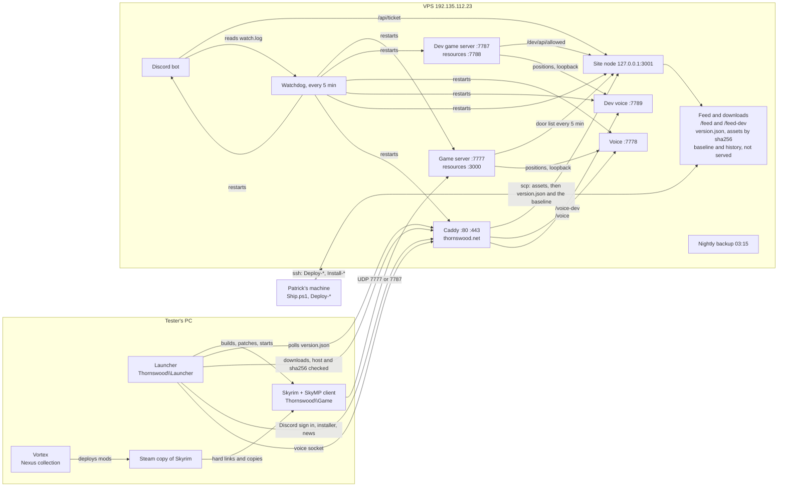

# How Thornswood fits together

One page, for somebody new, with or without AI. What runs where, what talks
to what, and which script puts each piece in place. Every port, folder and
task name here is read off a script; the file and line are beside it. If a
script and this page disagree, the script is right and this page needs a fix.
Developer-Guide.md is the long form and the rules.

## The three places things run

| Where | What runs there | Who touches it |
| --- | --- | --- |
| A tester's PC | The launcher, Skyrim from Thornswood's own game folder, Vortex, Steam | The person playing; the launcher looks after its own files |
| Any developer's machine that can sign | The repo, the SkyMP fork build, `Ship.ps1`, `Publish-*`, `Deploy-*`, `Install-*` | Developers. Any of them may ship dev and main (Developer-Guide.md) |
| The VPS, 192.135.112.23, Windows, user Administrator | Both game servers, both voice services, the site, Caddy, the bot, the watchdog, the nightly backup | Reached over ssh by the scripts; nobody edits it by hand |

<!-- VPS address: Deploy-Server.ps1:39, Deploy-Docs.ps1:41, Install-Bot.ps1:26, Install-Voice.ps1:32, launcher/app/Config.cs:256 -->

## The picture

## On a tester's PC

The launcher lives at `<drive>:\Thornswood\Launcher\Thornswood.exe` (C: on
most machines). Everything else hangs off that root, which is the folder above
the exe (`launcher/app/Paths.cs:42`):

| Folder or file | What it is | From |
| --- | --- | --- |
| `Thornswood\Launcher` | The exe, the WebView2 loader, the voice host page | `Paths.cs:53`, `DevBuild.cs:72` |
| `Thornswood\Game` | Thornswood's own Skyrim, built by the launcher from the Steam copy and what Vortex deployed; big files are hard links, anything rewritten in place is a copy | `Paths.cs:44`, Developer-Guide.md "One Skyrim of its own" |
| `Thornswood\Profile` | `launcher.log`, `applied.txt` (packs already in), `Packs\*.files` (what each pack wrote), `Default` (reference plugin list), `Keep` | `Paths.cs:54-66` |
| `Thornswood\config.json` | The launcher's settings. Server address, ports, update repo and branch; several are overwritten from the feed (see FEED.md) | `Paths.cs:66`, `Config.cs:133-147` |
| `Thornswood-DevBuild\` | The dev build: same exe, `Channel` and `UpdateBranch` set to `dev`, server port 7787, voice port 7789, voice address with `-dev` on the end. Installed from the main launcher's Play page Server card; staff roles only | `DevBuild.cs:26-27,49-52,126-130` |

With no `Game` folder the launcher reads the Steam copy (`Paths.cs:51`), but
Play will not start from it (Developer-Guide.md:32).

**Vortex and the Nexus collection.** The mods come from the Nexus collection
(`collectionUrl` in the feed,
`https://www.nexusmods.com/games/skyrimspecialedition/collections/7essxf`).
Vortex deploys it into the Steam copy, or into whatever folder Vortex manages;
the launcher finds that folder (`OwnGame.DeploysInto`) and builds `Game` from
the Steam copy's game plus exactly the files Vortex's record lists.

**The SkyMP client runtime** (six files) is built from the fork in
`engine\skymp`, recorded in `records\client-build.json`, and shipped both inside
packs and as its own asset named in the feed's `clientRuntime`
(`Publish-Update.ps1:955-990,1236-1245`, `ClientRuntime.cs:261-269`).

## Updates, the installer and the site

- **The feed.** Every launcher reads `version.json` from
  `https://thornswood.net/feed/version.json` (dev: `/feed-dev/`) since #649,
  and since #907 nowhere else: a site feed that does not answer is asked again
  on the next check (`Updater.Check`). Since #897 packs, the launcher exe and
  the client runtime are served by the site too, at
  `/feed[-dev]/assets/<sha256>`. FEED.md has every field.
- **Who writes it.** `Ship.ps1` runs `Publish-Update.ps1`, which diffs the game
  folder against this channel's baseline
  (`published.json`, received from the VPS store beside the channel's feed,
  `Feed-Store.ps1`), zips the difference, sends it and the launcher to the
  site's assets folder, rewrites `version.json` and sends it and the baseline
  back to the store, which is when the site serves it; `Publish-PostShip.ps1`
  then checks every asset the feed names is up with `Remirror-Site-Feed.ps1`. Then `Publish-News.ps1` (main only), then
  `Publish-Discord.ps1` (#news, or the dev updates channel), then
  `Request-Restart.ps1`, which warns the room for five minutes
  (`Ship.ps1:1033-1098`).
- **The installer.** `Package-Thornswood.ps1` builds `Thornswood-Setup` and
  `Publish-Installer.ps1` copies it over ssh into `C:\Thornswood-Docs\files`
  on the VPS (`Publish-Installer.ps1:45,157,198`). The setup program asks the
  site's `/api/payload` for `Thornswood-Setup.zip` (or a leftover stamped tip), its size and
  sha256 (`site/server.js:2247-2275`); people get it from
  `https://thornswood.net/downloads` (`server.js:2214-2215`). A dev release
  never touches the installer (`Ship.ps1:975-978`).
- **The site.** `site`, deployed by `Deploy-Docs.ps1` into
  `C:\Thornswood-Docs` (`Deploy-Docs.ps1:43`). Node listens on 3001
  (`server.js:34`) and, once `THORNSWOOD_DOCS_LOCAL=1` is set by
  `Setup-Domain.ps1:207`, only on 127.0.0.1 (`server.js:38`). Caddy holds 80 and
  443 for `thornswood.net` and `www.thornswood.net`, proxies `/voice/*` to
  7778, `/voice-dev/*` to 7789 and everything else to 3001
  (`scripts/deploy/Caddyfile:40-51`). The live Caddyfile is
  `C:\Thornswood-Caddy\Caddyfile` (`scripts/deploy/Caddyfile:4-6`). The site does
  Discord sign in, the public pages from `data\site\*.md`, news, uploads, the
  admin hub, and the door's lists.

## The door

No password decides who gets into the game; the server runs in offline mode
(Developer-Guide.md:279-290). Each game server's `gamemode.js` reads
`private\door.json` (the site address and the site's `botKey`, named here by
location only) and fetches the allowed list every five minutes into
`private\allowed.json` (`gamemode.js:11270-11276,11392`). The live server
asks `https://thornswood.net/api/allowed`; the dev server's `door.json` names
`https://thornswood.net/dev`, so it asks `/dev/api/allowed`, which lists Owner
and Dev only (`server.js:2921-2922`, Developer-Guide.md:35). The door turns
somebody away only when `allowed.json` says `"enforce": true`
(`gamemode.js:11008-11010`), which `Set-Door.ps1 -Enforce` sets.

## The VPS services

Every service is a Windows scheduled task. The watchdog starts a task by name
when its check fails, three times an hour at most (`Watch-Services.ps1:631-671`).

| Service | Folder on the VPS | Port(s) | Scheduled task | Deployed or set up by | From |
| --- | --- | --- | --- | --- | --- |
| Game server (live) | `C:\Thornswood-Server` | UDP and TCP 7777, resources TCP 3000 | `Thornswood Server` | `Deploy-Gamemode.ps1` builds it locally, `Deploy-Server.ps1` sends it; first install `Install-ThornswoodServer.ps1` | `Deploy-Server.ps1:41-42,228-230`, `Bootstrap-VPS.ps1:32-33,150-152`, `Install-ThornswoodServer.ps1:18-19` |
| Dev game server | `C:\Thornswood-Server-Dev` | UDP and TCP 7787, resources TCP 7788 | `Thornswood Dev Server` | Made once by `vps-dev-instance.ps1` (runs on the VPS); gamemode by `Deploy-DevGamemode.ps1` | `vps-dev-instance.ps1:9-10,64-69,102-112`, `Deploy-DevGamemode.ps1:108-109` |
| Voice (live) | `C:\Thornswood-Voice` | TCP 7778, and `/voice` through Caddy | `Thornswood Voice` | `Install-Voice.ps1` | `Install-Voice.ps1:34-35,66,345`, `voice-server.js:28` |
| Dev voice | `C:\Thornswood-Voice-Dev` | TCP 7789 on 127.0.0.1 only, and `/voice-dev` through Caddy | `Thornswood Dev Voice` | Made by `vps-dev-instance.ps1`; `Install-Voice.ps1 -Root C:\Thornswood-Voice-Dev -Port 7789 -TaskName 'Thornswood Dev Voice'` | `vps-dev-instance.ps1:11-12,77-97`, `voice/README.md:57-64` |
| Site | `C:\Thornswood-Docs` | 127.0.0.1:3001 | `Thornswood Docs` | `Deploy-Docs.ps1`, `-Site` for the public pages | `Deploy-Docs.ps1:43-45`, `server.js:34-38` |
| Caddy | `C:\Thornswood-Caddy` | 80, 443 | `Thornswood Web` (at startup and every five minutes) | `Setup-Domain.ps1`; the Caddyfile itself is kept in step with `scripts\deploy\Caddyfile` by hand | `Setup-Domain.ps1:30,183,248-266`, `scripts/deploy/Caddyfile:4-7` |
| Discord bot | `C:\Thornswood-Bot` | none | none: the Windows service `ThornswoodBot`, as `NT SERVICE\ThornswoodBot` (issue #465) | `Install-Bot.ps1`, `-CodeOnly` for the code, the card art and the live smoke's export | `Install-Bot.ps1`, `Bot-Service.ps1`, `BotService.cs` |
| Watchdog | `C:\Thornswood-Watch` (`watch.ps1`, `watch.log`) | none | `Thornswood Watch`, every five minutes as SYSTEM | `Watch-Services.ps1 -Install` | `Watch-Services.ps1:65-66,361` |
| Nightly backup | `C:\Thornswood-Backup` (passphrase in `key.txt`) | none | `Thornswood Backup`, daily at 03:15 | `Install-Backup.ps1`; `Fetch-Backups.ps1` brings them down | `Install-Backup.ps1:30-34,149-152`, `vps-nightly-backup.ps1:53-72` |

What the watchdog checks: `https://thornswood.net/` for Caddy, then TCP 3001,
3000, 7778, 7788 and 7789, and a python process with `Thornswood-Bot` in its
command line for the bot (`Watch-Services.ps1:595-679`). The bot writes
`heartbeat.json` in `C:\Thornswood-Bot\data` every minute (#1104), and a bot whose process runs but
which is hung or off Discord for ten minutes is down too; that is told about
and not restarted for (issue #449, `Watch-Services.ps1:217-300`,
`bot/bot.py:2408-2510`). From outside the box, the bot also pings an uptime
monitor every minute while it is on Discord, so a bot or a whole VPS that
stops is noticed when One is off too: the address is `PING_URL` in
`bot.env.json`, set by `Install-Bot.ps1 -SetPing`, and `bot/README.md` says
how to make the check (issue #449, `bot/bot.py:2513-2618`). It also asks the site,
both game servers and both voice servers over HTTP, which it tells about and
never restarts for, and checks the `Thornswood Backup` task's last result with
a backup under 26 hours old, the build runner's service, and writes DISK LOW
under 20 percent free on C: and DISK CRITICAL under 10. It tells the staff
channel once when any of these goes down and once when it is back (issue
#447): each message goes into `C:\Thornswood-Watch\alerts.jsonl`, the bot
posts it within a minute, and when the bot is down or silent the watchdog posts
it through the webhook in `alerts-webhook.txt` beside it
(`Watch-Services.ps1:22-47,302-573`, `bot/bot.py:1998-2098`).

What the backup takes: the live server's `world`, `private`, `data`,
`server-settings.json` and `gamemode.js`, and the same five from
`C:\Thornswood-Server-Dev` under `game-dev` (issue #401); the site's data,
config, uploads and each feed's store but not its downloads (issue #454); the
bot's config and join record; the voice service's `choices.json`; the
Caddyfile. Encrypted, seven daily and four weekly kept
(`vps-nightly-backup.ps1:8-55`). It takes nothing from
`C:\Thornswood-Voice-Dev`. The copy off the box is pulled to Patrick's machine
over ssh by the `Thornswood Fetch Backups` task there (`Fetch-Backups.ps1
-Schedule`), never served over HTTPS; `Restore-Server.ps1` puts one back into
a server folder, `Restore-Box.ps1` puts all of it onto a new box, and
`tests\test-backup-restore.ps1` and `tests\test-new-box-runbook.ps1` prove the
round trip.

A deploy sends a commit or nothing (issue #1121): `Deploy-Docs.ps1`,
`Install-Voice.ps1`, `Install-Bot.ps1`, `Deploy-DevGamemode.ps1`,
`Deploy-Server.ps1` and `Publish-Server.ps1` refuse, before they talk to the
box, when a file they would send out of the repository has uncommitted
changes or is untracked, and name each one (`Assert-ThornswoodCommitted` in
`scripts\deploy\Artifact.ps1`). There is no switch past it.
`Deploy-Docs.ps1` and `Install-Voice.ps1` then check the site or voice tree
they are about to send, file by file, against that same commit
(`Assert-ThornswoodSourceIntegrity`, issue #1335). The zip, the expanded
tree and the commit's own bytes have to be the same hashes. If they are not,
nothing is sent and the box is not touched. The hash compare Deploy-Docs
already makes of server.js and the public files, on the box, is unchanged.

How a deploy replaces what runs (issue #446): nothing is written over a
running service any more. The new files go into `<folder>\.stage-<stamp>`
while the old one runs, the box checks them there (each file by its hash, the
program parsing, the load order resolving), and a refusal stops nothing. Only
then is it stopped, the files renamed in, started and asked whether it
answers; if it does not, the old files go back and it is started again, and
the run says `SWAP ROLLED BACK` and fails. What a deploy replaced stays in
`<folder>\.prev-<stamp>`, the newest two, and `-PutBack` puts the newest
back the same way, keeping what it took out in `.undone-<stamp>`:
`Deploy-Server.ps1`, `Deploy-DevGamemode.ps1`, `Deploy-Docs.ps1`,
`Install-Voice.ps1` and `Install-Bot.ps1` all take it, and the blocks that do
it on the box are `scripts\deploy\Swap.ps1`. The record of what a part runs (issue #459,
`C:\Thornswood-Deploys`) is written only once the swap has answered; the one
it had goes into `.prev` with the files it describes, and `-PutBack` brings it
back and tells the store. A whole server install through
`Publish-Server.ps1` does the same one level up: the payload is unpacked to
`C:\Thornswood-Server.stage-<stamp>` beside the root, the old root becomes
`C:\Thornswood-Server.prev-<stamp>` (the newest two kept, each a whole
server folder, so they cost disk), the world, the roster, the runtime data and
the logs are carried across, and a server that does not answer is swapped
back and kept as `.failed-<stamp>` to read. `Publish-Server.ps1 -PutBack`
puts the newest `.prev` back. What a publish expects and does not find stops
it, never skipped without a word (issue #1336): `Export-ServerPayload.ps1`
refuses a build with no `gamemode.js` (skymp5-server logs the missing file and
runs on with no gamemode, so no door and no join pass) and a load order naming
a plugin the machine does not have, and the installer refuses a stage with no
`gamemode.js`. A dev publish gives the dev door the live `door.json`'s address,
key and join pass key; when the live one, or any of those three, is not there,
the dev door is left as it was and the publish stops with exit 1
(`DOOR NOT CARRIED`). The settings lines a deploy prints name every release
key the release does not carry, which stays as the running server has it.
`tests\test-1336-missing-stops.ps1` holds all of it. The documents and public pages the site serves
from `data` are content, not the app, and still go up in place with a `.bak`.
The harnesses are `tests\test-deploy-swaps.ps1`,
`tests\test-install-server.ps1` and `tests\test-deploy-server-swap.ps1`.

## How the pieces talk

- **Launcher to game server:** the SkyMP client connects to `serverAddress` and
  `serverPort` from the feed, UDP 7777 live or 7787 dev (`Config.cs:256-257`,
  `DevBuild.cs:26`).
- **Game server to voice:** `gamemode.js` pushes positions five times a second
  to `127.0.0.1:<thornswoodVoicePort>` from its own `server-settings.json`,
  falling back to 7778 (`gamemode.js:253-258,10641`, `Install-Voice.ps1:8-12`).
  `Deploy-DevGamemode.ps1` sets 7789 for dev (`Deploy-DevGamemode.ps1:110-114`).
- **Launcher to voice:** the voice page holds a WebSocket to `voiceUrl`
  (`https://thornswood.net/voice` or `/voice-dev`) or, with that empty, the raw
  port. Audio goes between people directly (`Install-Voice.ps1:8-12`).
- **Bot to site:** `/api/ticket` with the site's `botKey` (`bot.py:27,277`).
- **Game server to site:** the door list (above) and `/api/roster`
  (`gamemode.js:10900-10906`).

## What runs on a developer's machine

`Ship.ps1`, `Publish-*`, `Repair-Manifest.ps1`, `Bump-Version.ps1`, every
`Deploy-*` and `Install-*`, and `Request-Restart.ps1`. The engine build and the
release output (`out`, ignored by git) are in the repo folder; `scripts\release\Where.ps1`
says where (`Where.ps1:71-82`). The feed and its baseline are received from
the VPS into `%LOCALAPPDATA%\Thornswood\feed\main` and `\dev`, working copies
with a backup of the last twenty of each, not git clones (`Feed-Store.ps1`,
#907). Which command each
change needs after a merge: Developer-Guide.md, "After a pull request is merged".

## Where the sources disagree

- `Setup-Domain.ps1:136-142` writes a Caddyfile with only
  `reverse_proxy 127.0.0.1:3001`, and writes it on every run without
  `-TaskOnly` (`Setup-Domain.ps1:130,179-181`). `scripts/deploy/Caddyfile:43-49` has the
  `/voice` and `/voice-dev` blocks that both feeds' `voiceUrl` now point at.
  Running `Setup-Domain.ps1` again would take voice through Caddy away.
- `Install-Backup.ps1:32` says 03:15 is "after the nightly restart". No script
  in `tools` registers a nightly restart task.
- `DevBuild.cs:21-22` says both launchers share the one Skyrim, and
  `DevBuild.cs:92` copies `developer.flag`. Developer-Guide.md:431-435 says the dev
  build makes its own `<Root>-DevBuild\Game`, and Developer-Guide.md:180-182 says
  nothing writes `developer.flag` since 25 September.
